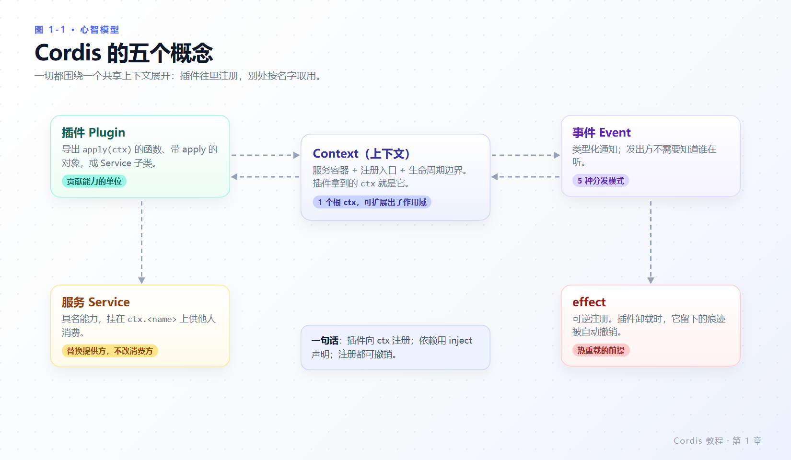
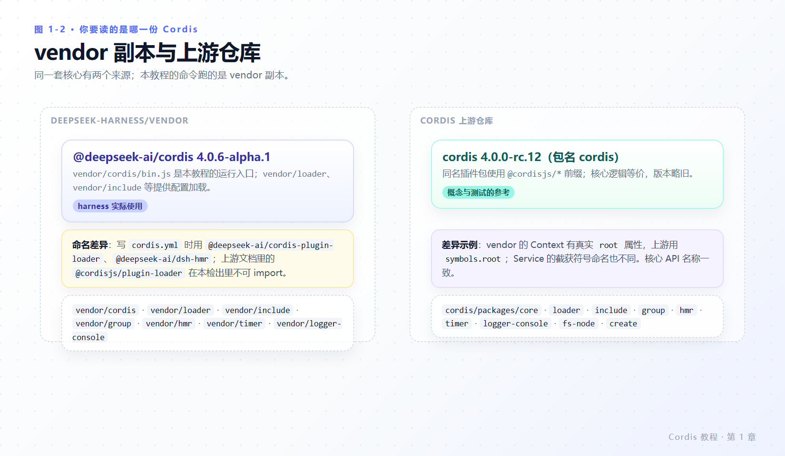

# 第 1 章 认识 Cordis

> **本章目标**
>
> - 说清 Cordis 用哪四个决定替换传统的模块 import。
> - 记住五个概念：插件、上下文、服务、事件、effect，并知道它们各自回答什么问题。
> - 分清本教程跑的是哪一份 Cordis：`deepseek-harness/vendor` 副本，还是上游 `cordis` 仓库。
> - 掌握全书术语写法（fiber、effect、PENDING、waterfall、否决）。
>
> **前置知识**：会用终端，写过任意一门 C 风格语言。TypeScript 只需要读得懂函数和类；不认识的语法在每一章都会被解释。

---

## 1.1 如果没有 Cordis

假设你在写一个 agent 程序：工具需要模型，模型需要会话，会话需要落盘，落盘需要文件系统……最直接的写法是互相 import：

```ts
// tools.ts
import { llm } from './llm.ts'
import { sessions } from './sessions.ts'
```

三件事会立刻找上门：

1. **换不掉。** 想换一个 shell 实现，就得改所有 import 它的文件。
2. **清不干净。** 想热重载一个模块，必须自己记得它注册过哪些监听器、开过哪些定时器、起过哪些子进程。
3. **排不出序。** 启动顺序写死在代码里，A 依赖 B 就得保证 B 先跑；一旦并发，`undefined is not a function` 会在随机时刻出现。

Cordis 用四个决定替换这套写法：

| 决定 | 替换掉什么 | 出现的位置 |
|---|---|---|
| 能力注册进共享上下文，而不是互相 import | 静态依赖图 | `ctx.plugin()`、`ctx.tools.register(...)` |
| 依赖用 `inject` 声明，由可用性驱动启动 | 手写启动顺序 | `export const inject = ['tools']` |
| 所有注册都是可逆的 effect | 手动 `removeListener` | `ctx.effect()`、`ctx.on()` |
| 能力按名字查找，提供方可以被替换 | 具体实现的引用 | `ctx.<name>`、`ctx.get('<name>')` |

这四条不是抽象口号，后一章一章会被你亲手跑出来：第 3 章你会看到卸载自动回卷，第 4 章会看到提供方消失时消费方自动重启，第 5 章会看到五种分发模式，第 7 章会看到改一行 YAML 引发的重挂。

---

## 1.2 五个概念



*图 1-1 · 一切都挂在同一个 `ctx` 上：插件负责注册，服务提供具名能力，事件负责通知，effect 保证这一切可撤销。*

逐个说清它们各自回答什么问题：

- **插件（Plugin）**回答“这段代码什么时候被执行”。它是一个导出 `apply(ctx)` 的函数、带 `apply` 方法的对象，或一个 `Service` 子类。Cordis 挂载它时调用 `apply`，并把上下文交给它。
- **上下文（Context）**回答“我能注册到哪里”。它就是 `apply(ctx)` 里的那个 `ctx`：既是服务容器，也是注册入口，还是生命周期边界——通过这个 `ctx` 注册的一切，归属于当前插件。
- **服务（Service）**回答“我需要什么能力”。一个插件用名字公开一项能力，别人用同一个名字消费，双方都不 import 对方。harness 里的 `ctx.tools`、`ctx.llm`、`ctx.systemPrompt` 都是服务。
- **事件（Event）**回答“发生了什么事，谁想对此做点什么”。发出方不需要知道有没有人在听，也不需要知道有几个在听。
- **effect** 回答“我留下的痕迹由谁擦”。通过 Cordis API 建立的注册本身就是 effect；Cordis 不认识的资源（定时器、连接、watcher）要手动包进 `ctx.effect()`，并在其中返回 disposer。

一句可执行的心智模型：**插件向 `ctx` 注册；依赖用 `inject` 声明；注册都可撤销。**

---

## 1.3 一次挂载都发生了什么

把第 2 章你会运行的最小示例提前拆开看。`cordis.yml` 里的一行配置，最后落到三个动作：

```text
cordis.yml 的一行
  → Loader 解析 name 字段（相对路径 / NPM 包名）
  → import 该模块，取出插件形态（函数 / apply 方法 / Service 子类）
  → registry.plugin(...) 创建一个 fiber，调用 apply(ctx[, config])
```

`fiber` 是“一个已加载插件实例”的运行时句柄，携带状态、校验过的配置和它注册的作用。它会在 PENDING／LOADING／ACTIVE／FAILED／UNLOADING／DISPOSED 之间转换（第 3 章完整展开）。你几乎不需要直接操作 fiber，但它解释了你之后会看到的所有现象：为什么插件可以“没反应”（PENDING），为什么热重载不需要你自己擦注册（UNLOADING 会回卷 effect）。

术语来自源码，不是本教材的发明：`vendor/cordis/src/fiber.ts:147` 定义了 `FiberState`，`vendor/cordis/src/registry.ts:185` 定义了 `ctx.plugin()` 的返回类型 `Fiber & PromiseLike<Fiber>`。

---

## 1.4 你要读的是哪一份 Cordis

这里有一个新手极易踩的环境坑：同一台机器上可能存在**两份**Cordis，包名不同，能 import 的东西也不同。



*图 1-2 · 本教程的命令一律跑 vendor 副本；上游仓库用来读概念和测试。包名前缀不通用。*

| | 本教程运行它 | 概念参考 |
|---|---|---|
| 位置 | `deepseek-harness/vendor/*` | `cordis/packages/*` |
| 核心包名 | `@deepseek-ai/cordis`（`4.0.6-alpha.1`） | `cordis`（`4.0.0-rc.12`） |
| 插件包名前缀 | `@deepseek-ai/cordis-plugin-*`、`@deepseek-ai/dsh-hmr` | `@cordisjs/plugin-*` |
| 入口 | `vendor/cordis/bin.js`（harness 专用启动器） | 无对应 bin |

写 `cordis.yml` 时以 `vendor` 的命名为准。把上游文档里的 `@cordisjs/plugin-loader` 抄进本仓库的配置项，结果是模块解析失败——而且**不会有任何报错**（原因见[第 2 章 2.5 节](02-first-plugin.md#25-尝试制造错误)）。

两份代码有细微差异，但核心 API 名称一致：例如 vendor 的 `Context` 暴露真实属性 `root`（`vendor/cordis/src/context.ts:75`），上游把根存在 `symbols.root` 上；`Service` 的截获符号命名也不同。本教程只讲两边一致的部分，并在涉及实现细节时明确标注“以 vendor 副本为准”。

---

## 1.5 全书约定

**怎么标记证据。** 本教程区分三种陈述，你会在正文里看到这些字样：

- **实测** —— 作者在本机跑出来的输出，逐字粘贴，包含退出码。复现环境：Windows 10 x64、Node `v24.15.0`、`tsx 4.23.13`、`vendor/cordis 4.0.6-alpha.1`、`vendor/loader 1.0.7-alpha.1`，日期 2026-10-30。
- **官方教程** —— 引用 [Cordis 教程](https://deepseek-harness.github.io/deepseek-harness/develop/cordis-tutorial/01-first-plugin)与仓库内 `docs/cordis-tutorial/*.zh.md`。
- **源码** —— 以反引号给出仓库相对路径和行号，根目录是 `deepseek-harness/`。

三者冲突时，本教程以实测和源码为准，并把冲突单列成“与官方文档的差异”。这类差异一共四处（启动期报错的可见性、配置校验失败的退出码、第 7 章的工具组合、`!!js` 的归属），都带有你自己的终端可复现的命令。

**术语写法。** 沿用官方中文文档的用词，不重新发明：

| 术语 | 写法 | 为什么这样 |
|---|---|---|
| fiber | 保留英文 | 官方教程与 `docs/cordis-api/fiber.zh.md` 都不译 |
| effect / disposer | 首次给中文注（资源释放函数） | 官方中文同此 |
| PENDING / ACTIVE / FAILED | 保留大写英文 | 是枚举名，不是比喻 |
| waterfall | 瀑布式事件 | `docs/cordis-tutorial/04-events.zh.md:90` |
| 不调用 `next()` 直接返回 | **否决** | `docs/cordis-api/events.zh.md:118` |
| inject | 保留英文 | 它是导出字段名 |

**代码路径。** 示例文件都写在 `deepseek-harness/tmp/cordis-tutorial/`（`tmp/` 已被 git 忽略，随便造）。每章给出该章的文件清单，跑的是同一条命令：

```sh
node --import tsx ../../vendor/cordis/bin.js
```

**检查点。** 每章末尾有“检查点”，是能自测的是非题；答不上来就回到对应小节。

---

## 1.6 全书地图

| 章 | 主题 | 你会得到 |
|---|---|---|
| [第 1 章](01-what-is-cordis.md) | 认识 Cordis | 五个概念与环境判别 |
| [第 2 章](02-first-plugin.md) | 第一个插件 | `hello.ts` 跑通、三种形态、启动器解剖 |
| [第 3 章](03-lifecycle-and-effects.md) | 生命周期与 effect | fiber 状态机、disposer 的真实顺序 |
| [第 4 章](04-services-and-inject.md) | 服务与 `inject` | 提供方/消费方、依赖反应性、可选依赖的坑 |
| [第 5 章](05-events.md) | 事件 | 五种分发模式、waterfall 否决 |
| [第 6 章](06-config.md) | 配置 | schema 校验、`!!js`、volatile 字段 |
| [第 7 章](07-composition-and-hmr.md) | 组合与热重载 | 配置项元数据、`id`、HMR、PENDING 诊断 |
| [第 8 章](08-into-the-harness.md) | 进入 harness | 注册模型可调用工具、观察 `tools/result` |
| [第 9 章](09-internals.md) | 内核视角 | `ctx` 为什么是 Proxy、epoch 与 `reflect.notify` |
| [第 10 章](10-pitfalls-and-debugging.md) | 陷阱与调试 | 错误可见性、竞态、静默失败排查配方 |
| 附录 | API 速查 / 术语 / 源码索引 | 三张表 |

三条阅读路径：

- **只想会用最小 API**：第 1 → 2 → 3 → 4 → 5 章。
- **要为 harness 写插件**（推荐主线）：全书顺序，第 8 章之后按需跳第 10 章。
- **在做架构评审或排障**：第 1 → 7 → 9 → 10 章 + 附录 C。

---

## 1.7 本章小结

- Cordis 把“能力之间的静态 import”换成“向共享上下文注册具名能力”，并用 `inject` 与 effect 解决顺序与清理。
- 五个概念各答一问：插件（何时执行）、上下文（注册到哪）、服务（需要什么能力）、事件（发生了什么）、effect（谁来擦痕迹）。
- 本教程运行 `deepseek-harness/vendor` 副本（`@deepseek-ai/*` 包名），上游 `cordis` 仓库（`@cordisjs/*`）只作概念参考；两者包名不可混用。
- 每条陈述标清来源：实测 / 官方教程 / 源码行号；冲突处单列差异。

### 检查点

1. 为什么“换一个实现要改所有调用方”在 Cordis 里不成立？
2. `apply(ctx)` 里的 `ctx` 承担哪三件事？
3. 在 `deepseek-harness` 的检出里，`cordis.yml` 能写 `@cordisjs/plugin-loader` 吗？为什么？
4. “插件”“服务”“事件”三者中，哪一个负责“发生了什么事”？

## 延伸阅读

- [Cordis 教程 · 索引](https://deepseek-harness.github.io/deepseek-harness/develop/cordis-tutorial/)（官方，含准备工作与 TypeScript 说明）
- 仓库内 `docs/cordis-primer.zh.md`：五个概念与分发模式的精简参考。
- `docs/cordis-api/`：由 `scripts/gen-cordis-catalog.ts` 生成的 Context / Events / Fiber / Registry / Service 参考。
- `docs/subsystems/core.zh.md`：harness 已注册的服务与事件名清单（`cordis-surface` 区块）。
