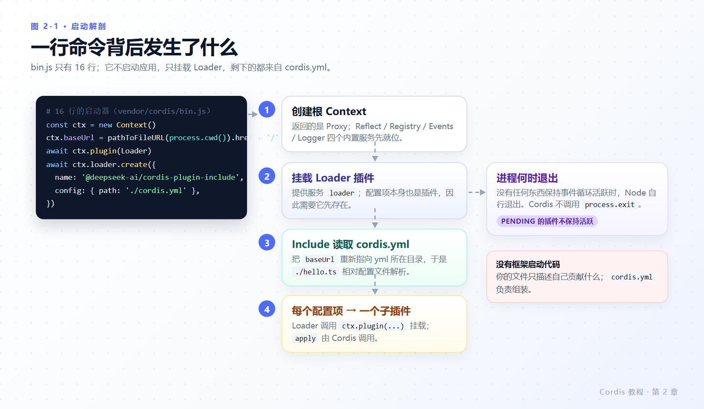
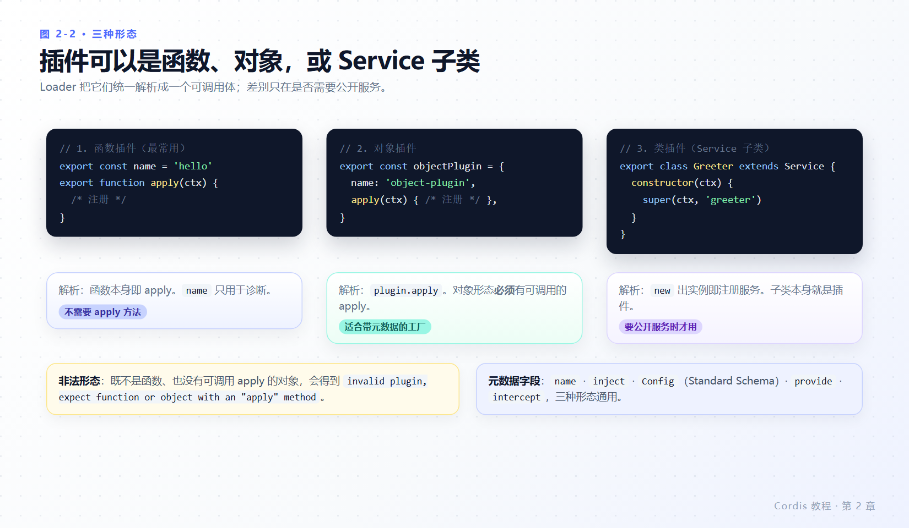

# 第 2 章 第一个插件

> **本章目标**
>
> - 搭好可运行的环境，把 `hello.ts` 跑起来。
> - 看懂 16 行启动器 `vendor/cordis/bin.js` 到底做了什么，以及 `cordis.yml` 从哪里被读取。
> - 分清三种插件形态各自的解析规则。
> - 亲手制造两类失败：`apply` 抛错、模块名拼错，并理解**为什么终端上一行错误都看不到**。
> - 学会用 `ctx.logger.buffer` 把启动期被吞掉的错误捞出来。
>
> **前置知识**：第 1 章；会创建目录和编辑文本文件。
>
> **本章实验**：全部在 `deepseek-harness/tmp/cordis-tutorial/`，不需要任何模型密钥。

---

## 2.1 准备工作

需要克隆仓库并安装依赖（官方前置条件见[开发指南](https://deepseek-harness.github.io/deepseek-harness/develop/)）：

```sh
git clone https://github.com/deepseek-ai/deepseek-harness.git
cd deepseek-harness
pnpm install
```

创建各章共用的工作目录。`tmp/` 已被 git 忽略，你在里面写任何内容都不会进入版本控制：

```sh
mkdir -p tmp/cordis-tutorial
cd tmp/cordis-tutorial
```

本章文件清单：

```text
tmp/cordis-tutorial/
├── cordis.yml        # 每次实验换内容，文件名不变
└── hello.ts          # 第一个插件
```

全书都跑同一条命令：

```sh
node --import tsx ../../vendor/cordis/bin.js
```

`--import tsx` 是 Node 的 ESM 加载钩子注册，让 `import` 能直接吃 `.ts` 文件；它不参与 Cordis 的任何逻辑——配置解析、插件挂载都是 Loader 与 Include 的事（第 9 章会验证这一点）。

> **常见环境问题**
>
> 如果你的 `deepseek-harness` 目录是**移动或复制**过来的（不是重新 clone），`node_modules` 里的符号链接仍然指向旧路径，`pnpm install` 会先要求清空 `node_modules`。本教程编写时遇到过这一情况：`node_modules` 顶层 31 个链接、全仓库 8958 个链接全部指向已删除的旧目录，`node --import tsx` 报 `ERR_MODULE_NOT_FOUND: Cannot find package 'tsx'`。
>
> 判别方法：`ls -la node_modules/tsx` 看链接目标是否存在。修复方法：重新 `pnpm install`（会重建链接），或把所有指向旧检出根目录的链接批量改写。不要手工删包目录。

---

## 2.2 启动器解剖

`vendor/cordis/bin.js` 一共 16 行，全文如下（`vendor/cordis/bin.js:1-16`）：

```js
#!/usr/bin/env node

import { Context } from '@deepseek-ai/cordis'
import { pathToFileURL } from 'node:url'
import Loader from '@deepseek-ai/cordis-plugin-loader'

const ctx = new Context()
ctx.baseUrl = pathToFileURL(process.cwd()).href + '/'

await ctx.plugin(Loader)
await ctx.loader.create({
  name: '@deepseek-ai/cordis-plugin-include',
  config: {
    path: './cordis.yml',
  },
})
```



*图 2-1 · 四个动作：建根 Context → 挂 Loader → 把 `cordis.yml` 作为 Include 配置项挂载 → 每个配置项成为一个子插件。*

值得逐条记住的行为：

1. **`ctx.baseUrl` 取的是 `process.cwd()`**（`bin.js:8`），不是 `bin.js` 自己所在目录。所以命令必须从 `tmp/cordis-tutorial/` 里执行；在别处执行会找不到 `cordis.yml`——而且同样不报错（见 2.5）。
2. **配置文件本身也是一个插件。** `bin.js:11-16` 把 `@deepseek-ai/cordis-plugin-include` 作为一个配置项挂载。Include 在构造时把 `ctx.baseUrl` 重新指向 yml 所在目录（`vendor/include/src/index.ts`），于是 `./hello.ts` 相对**配置文件**解析，而不是相对你终端的当前位置。
3. **没有 `process.exit`，没有信号处理。** `bin.js` 里一个 `try` 都没有，也没有 `process.on('exit')` 或 SIGINT 处理；`Loader.exit()` 是个空钩子（`vendor/loader/src/index.ts:196-197`）。进程能活着，唯一原因是挂载中的插件持有事件循环（定时器、watcher）；没人持有，Node 自然退出。这条决定了本章后半部分所有的“静默”。
4. **Loader 提供服务 `loader`**，所以配置项也是插件这一点才有实现路径：先有 Loader，才谈得上“按 YAML 挂载”。

---

## 2.3 写第一个插件

创建 `hello.ts`：

```ts
import type { Context } from '@deepseek-ai/cordis'

export const name = 'hello'

export function apply(ctx: Context) {
  console.log('hello from my first plugin')
}
```

创建 `cordis.yml`：

```yaml
- name: './hello.ts'
```

运行：

```sh
node --import tsx ../../vendor/cordis/bin.js
```

**实测**（退出码 0）：

```text
hello from my first plugin
```

`name` 导出是可选的显示元数据，只用于诊断信息（`vendor/cordis/src/registry.ts:101-102` 的 `Plugin.Base.name?`）。你在第 7 章会看到它出现在注册表快照里。

`cordis.yml` 是一组配置项的列表，`name` 是模块指定符（相对路径或 NPM 包名）。**各项并发启动**，因此它在列表中的位置不保证加载先后——顺序由服务依赖（`inject`，第 4 章）决定。

一份真实的应用组合就是这样一个列表，只是长得多：harness 的 [base 层 `cordis.patch.yml`](https://github.com/deepseek-ai/deepseek-harness/blob/master/packages/bundle/base/cordis.patch.yml) 有 531 行、97 个配置项，部署时再由 overlay 对它打补丁（第 8 章带你看其中几行）。

---

## 2.4 三种插件形态

函数最常见，但 Cordis 接受三种形态（`vendor/cordis/src/registry.ts:92-95` 的 `type Plugin = Plugin.Function | Plugin.Constructor | Plugin.Object`）：



*图 2-2 · 解析规则不同：函数即 apply；对象必须带可调用 `apply`；`Service` 子类实例化时顺带注册服务。*

```ts
import { Service, type Context } from '@deepseek-ai/cordis'

// 形态 1：函数插件（你刚写的那个）
export function apply(ctx: Context) {}

// 形态 2：对象插件：带 apply 方法的对象
export const objectPlugin = {
  name: 'object-plugin',
  apply(ctx: Context) {},
}

// 形态 3：类插件：Service 子类（第 4 章展开）
export class MyService extends Service {
  constructor(ctx: Context) {
    super(ctx, 'myTutorialService')
  }
}
```

解析发生在 `vendor/cordis/src/registry.ts:222-228`：函数直接用；对象若有可调用的 `apply` 则取 `plugin.apply`；两者都不满足时 `resolve()` 返回 `undefined`，由调用方 `plugin()` 抛出（`:319`）：

```text
invalid plugin, expect function or object with an "apply" method, received ...
```

两个容易误解的点：

- **函数形态不需要 `apply` 方法**——`ctx.plugin(myFunction)` 直接调用该函数；第 3 章会用到这一点。只有对象形态才要求 `apply`。
- **元数据三态通用**：`name`、`inject`、`Config`（Standard Schema）、`provide`、`intercept` 都可以挂在函数导出的模块上、对象的字段上，或类的静态成员上。

在需要公开服务之前，请一直用函数形态。

---

## 2.5 尝试制造错误

这一节是本教程与官方教程分歧最大的一节，也是你之后排障最有用的一节。**下面每一条都带实测输出。**

### 实验 A：让 `apply` 抛异常

把 `hello.ts` 换成 `boom.ts`：

```ts
import type { Context } from '@deepseek-ai/cordis'

export const name = 'boom'

export function apply(ctx: Context) {
  throw new Error('apply exploded')
}
```

```yaml
- name: './boom.ts'
```

**实测**：终端**什么都没有**，退出码 **0**。

```text
(no output)
```

官方教程[第 1 章](https://deepseek-harness.github.io/deepseek-harness/develop/cordis-tutorial/01-first-plugin)写的是“再次运行：进程会因该错误而终止”。在当前检出的 `vendor/cordis 4.0.6-alpha.1` 上不成立。机制在两处源码里：

- 加载期异常被 fiber 捕获后**交给 logger**，不再向上抛：`vendor/cordis/src/fiber.ts:686-691`
  ```ts
  } catch (reason) {
    this.ctx.logger.error(reason)
    this._error = reason
    this._runner.epoch = INACTIVE
  }
  ```
  插件的 fiber 进入 FAILED 状态（`_error` 非空即 FAILED，`fiber.ts:574-579`），但没人崩溃。
- 根 `LoggerService` 构造时只注册了**一个内存 buffer 导出器**（`vendor/cordis/src/logger.ts:195-196, 213-221`，`bufferSize = 1000`），而 `vendor/cordis/bin.js` 没有挂任何控制台导出器，也没有代码回读这段 buffer。

结论：**错误被记录了，只是没有出口。**

### 实验 B：加控制台导出器也没用

```yaml
- name: '@deepseek-ai/cordis-plugin-logger-console'
- name: './boom.ts'
```

**实测**：仍然 `(no output)`，退出码 0。

原因是并发启动竞态：`ConsoleExporter` 在**自己的构造函数里**调用 `ctx.logger.exporter(this)` 才挂上（`vendor/logger-console/src/shared.ts:54-58`），而配置项之间并发挂载（第 7 章 7.2 给出源码位置）。启动阶段记录的消息，导出器往往还没就位。官方教程对此的措辞是“这条报告可能在 console 导出器开始观察之前丢失”——实测在 `apply` 抛错这一类**启动期**消息上是稳定复现的，不是偶发。

判别实验（`logger-probe.ts`，在 `apply` 里记一条、800 ms 后再记一条）：

```yaml
- name: '@deepseek-ai/cordis-plugin-logger-console'
- name: './logger-probe.ts'
```

**实测**：

```text
2026-10-30 12:45:32 [I] logger-probe info at t=800
2026-10-30 12:45:32 [E] logger-probe Error: error at t=800
                            at Timeout._onTimeout (.../logger-probe.ts:10:22)
(buffer length at t=800: 4)
```

`apply` 里那两条（`info at apply` / `error at apply`）没有打印，`t=800` 的两条打印了；buffer 长度 4 说明四条**全部留存**。导出器就位后的消息可见，之前的不可见。

### 实验 C：把 buffer 读出来

这是本章最重要的可复用技巧。创建 `log-replay.ts`：

```ts
import type { Context } from '@deepseek-ai/cordis'

export const name = 'log-replay'

export function apply(ctx: Context) {
  setTimeout(() => {
    const buffer = (ctx.logger as any).buffer as any[]
    console.log(`buffered messages: ${buffer.length}`)
    for (const msg of buffer) {
      const first = msg.args?.[0]
      const text = first instanceof Error ? `${first.name}: ${first.message}` : String(first)
      console.log(`  [${msg.type}] ${msg.name} — ${text}`)
    }
    process.exit(0)
  }, 600)
}
```

它自己用 `setTimeout` 保持事件循环活跃，因此一定有机会回读。

```yaml
- name: './boom.ts'
- name: './log-replay.ts'
```

**实测**：

```text
buffered messages: 1
  [error] boom — Error: apply exploded
```

同一个手法把两类失败都挖了出来：

| 场景 | `cordis.yml` | 终端直接看 | 用 `log-replay` 看 |
|---|---|---|---|
| `apply` 抛错 | `./boom.ts` | 空 | `[error] boom — Error: apply exploded` |
| 模块名拼错 | `./does-not-exist.ts` | 空 | `[error] include — Error: Cannot find module '...\does-not-exist.ts' imported from ...\tmp\cordis-tutorial\` |
| 配置校验失败（第 6 章） | `./config-demo.ts` + 错误 `targets` | 空 | `[error] config-demo — ValidationError: invalid config: - $.targets expected array but got not-an-array (at targets)` |

### 实验 D：模块无法解析

```yaml
- name: './does-not-exist.ts'
```

**实测**：`(no output)`，退出码 0。这条官方教程说对了：**解析失败不会使进程崩溃**，而是通过 logger 报告（`vendor/loader/src/config/entry.ts:223-230`）：

```ts
private async _init() {
  let moduleNamespace: unknown
  try {
    moduleNamespace = await this.parent.tree.import(this.options.name, this.getOuterStack)
  } catch (error) {
    this.ctx.logger.error(error)
    return
  }
```

注意它只 `return`，不重抛——所以配置项被静默跳过。加上 2.2 节说的“`cordis.yml` 找不到时也只是没人挂载”，你会得到本框架最重要的一条排障纪律：

> **新增配置项没有任何效果时，第一嫌疑是拼写；第一手段是 `ctx.logger.buffer`，第 7 章的注册表快照是第二手段。**

---

## 2.6 本章小结

- `bin.js` 只做四件事：建根 Context、挂 Loader、把 `cordis.yml` 作为 Include 挂载、由 Loader 挂载每个配置项。它没有错误处理，也没有保活逻辑。
- `ctx.baseUrl` 来自 `process.cwd()`；`./xxx.ts` 最终相对 **yml 所在目录**解析。
- 插件三种形态：函数直接用、对象要 `apply`、`Service` 子类实例化即注册。
- 在当前版本，`apply` 抛错与模块解析失败都**不崩溃、不打印、退出码 0**；消息进入根 logger 的 1000 条 buffer。控制台导出器只对“挂上之后”的消息有效。
- 看到启动期错误的可靠办法：挂一个稍后时刻回读 `ctx.logger.buffer` 的插件。

### 检查点

1. 把 `node --import tsx ../../vendor/cordis/bin.js` 改到 `deepseek-harness/` 根目录执行，会发生什么？为什么没有报错？
2. 想让 `./hello.ts` 相对某个子目录解析，需要改的是命令行还是 `cordis.yml` 的位置？
3. `ctx.plugin(someFunction)` 需要 `someFunction.apply` 存在吗？对象形态呢？
4. 你的插件 `apply` 里 `throw` 之后，终端空、退出码 0。请问错误现在在哪里？怎么把它打出来？

## 延伸阅读

- 官方：[你的第一个插件](https://deepseek-harness.github.io/deepseek-harness/develop/cordis-tutorial/01-first-plugin)
- 仓库：`docs/cordis-tutorial/01-first-plugin.zh.md`、`docs/cordis-primer.zh.md`
- 源码：`vendor/cordis/bin.js`、`vendor/cordis/src/registry.ts:92-133, 222-228, 319`、`vendor/cordis/src/fiber.ts:686-691`、`vendor/cordis/src/logger.ts:193-221`、`vendor/loader/src/config/entry.ts:223-230`
- 下一轮：[第 3 章 生命周期与 effect](03-lifecycle-and-effects.md)，看卸载时这些注册去了哪里。
