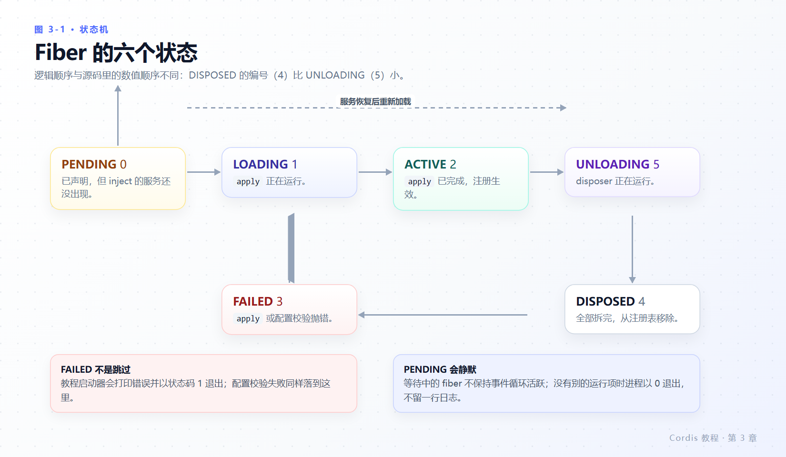
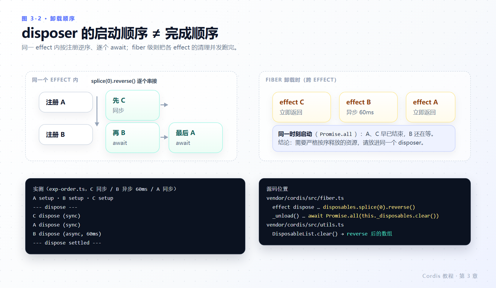

# 第 3 章 生命周期与 effect

> **本章目标**
>
> - 说清一个插件在什么情况下会被卸载，以及卸载时谁负责擦痕迹。
> - 会用 `ctx.effect()` 包装 Cordis 不认识的资源，并写对 disposer。
> - 掌握 Fiber 六个状态、它们的**源码数值顺序**，以及 PENDING 为什么静默。
> - 知道 disposer 的真实执行顺序：启动是逆序的，完成不一定是。
> - 分清哪些 API 已经是 effect，不需要你手动包装。
>
> **前置知识**：第 2 章（尤其是 2.5 的静默失败）。
>
> **本章实验**：`lifecycle.ts`、`exp-order.ts`，仍然不需要密钥。

---

## 3.1 插件会被卸载的四种原因

Cordis 插件会卸载，通常因为：

1. **配置改变** —— 你编辑了 `cordis.yml`，Loader 按 `id` 差分后卸载不再存在或已变更的配置项（第 7 章）。
2. **热重载** —— HMR 监视到源文件保存，先卸载旧实例再加载新代码（第 7 章）。
3. **显式释放** —— 有人调用了 `fiber.dispose()`（本章的 `lifecycle.ts`）。
4. **所需服务消失** —— 提供方被卸载或被替换，`inject` 它的插件随之卸载（第 4 章）。

如果注册不可逆，这四种情况中的每一种都会在应用里留下活着的定时器、监听器和连接。Cordis 的答案是：**通过 Cordis API 建立的注册本身就是 effect，会随所属插件卸载而撤销**；Cordis 不认识的资源必须你自己包进 `ctx.effect()`。

---

## 3.2 `ctx.effect()`：拿资源，还 disposer

创建 `lifecycle.ts`：

```ts
import type { Context } from '@deepseek-ai/cordis'

export const name = 'lifecycle-demo'

function heartbeat(ctx: Context) {
  console.log('heartbeat plugin loading')
  ctx.effect(() => {
    const timer = setInterval(() => console.log('tick'), 200)
    return () => {
      clearInterval(timer)
      console.log('heartbeat cleaned up')
    }
  })
}

export function apply(ctx: Context) {
  // Mount a child plugin and keep its fiber to dispose it later.
  const fiber = ctx.plugin(heartbeat)
  // The demo timer is itself an effect: if THIS plugin is unloaded first,
  // the pending callback is cancelled instead of firing on a dead app.
  ctx.effect(() => {
    const timer = setTimeout(async () => {
      await fiber.dispose()
      console.log('disposed')
      process.exit(0)
    }, 700)
    return () => clearTimeout(timer)
  })
}
```

```yaml
- name: './lifecycle.ts'
```

**实测**（退出码 0）：

```text
heartbeat plugin loading
tick
tick
tick
heartbeat cleaned up
disposed
```

三点必须留意：

- **`ctx.plugin(heartbeat)` 挂载的是来自代码的函数插件**，和 YAML Loader 对每个配置项做的事一模一样。函数形态不需要 `apply` 方法——Cordis 直接调用该函数，它的名字只用于诊断。对象形态才要求 `apply`：`ctx.plugin({ apply(ctx) { /* ... */ } })`。
- **调用返回一个 fiber**，即已加载插件实例的运行时句柄（`vendor/cordis/src/registry.ts:185`，返回类型 `Fiber & PromiseLike<Fiber>`，所以既能 `.dispose()` 也能 `await`）。
- **effect 主体在加载期运行，返回的 disposer 在卸载期运行**。生命周期与插件一致的资源，你永远不需要自己调 disposer。

最外面那个 `ctx.effect()` 是本章最值得学的写法：`setTimeout` 本身是 Cordis 不认识的资源。把它包进 effect 并返回 `clearTimeout`，于是“如果父插件先被卸载，这个还没触发的回调会被取消”，而不是在已死的应用上触发 `fiber.dispose()`。

### `dispose()` 会等到什么时候

`fiber.dispose()` 会等该插件的所有清理（包括异步 disposer）完成后才结束，并递归卸载它挂载的子插件。实现细节值得知道，因为它解释了为什么 `await` 一个 dispose 就足够：

- `dispose` 本身被注册为**父 fiber 的一个 effect**（`vendor/cordis/src/fiber.ts:265-297`）：置 `uid = null`、发出 `internal/plugin` 的卸载通知、从注册表移除。
- 然后 `while (this.inertia) await this.inertia`：把该插件正在进行或级联而来的清理全部等干。子插件是父插件的 effect，因此卸载会自然递归下去。

---

## 3.3 Fiber 状态机



*图 3-1 · 逻辑路径 PENDING→LOADING→ACTIVE→UNLOADING→DISPOSED，FAILED 从 LOADING 分出；注意枚举数值顺序与逻辑顺序不一致。*

每个已加载插件实例拥有一个 fiber，在这些状态之间转换（官方教程给的顺序图是 `PENDING → LOADING → ACTIVE → UNLOADING → DISPOSED`，`FAILED` 从加载分出）：

- **PENDING**：已声明，但 `inject` 的服务（第 4 章）尚不可用。
- **LOADING / ACTIVE**：`apply` 正在运行 / 已完成。
- **FAILED**：`apply` 或配置校验抛出异常。
- **UNLOADING / DISPOSED**：disposer 正在运行 / 一切已拆除。

**实测数值**（`exp-states.ts` 打印 `FiberState`，源码见 `vendor/cordis/src/fiber.ts:147-154`）。顺带一提：源码里它是 `export const enum`，跨文件时通常会被内联掉、运行时并不存在这个对象；这里能打印出来，是因为 tsx 按单文件转译，把 `const enum` 当成了普通枚举：

```text
FiberState = {"PENDING":0,"LOADING":1,"ACTIVE":2,"FAILED":3,"DISPOSED":4,"UNLOADING":5}
  Loader: state=2 uid=1 inject={}
  isolate: state=2 uid=2 inject={}
  Include: state=2 uid=3 inject={"loader":null}
  needs-timer: state=0 uid=4 inject={"timer":null}
  exp-states: state=2 uid=5 inject={}
```

三个从这份快照里就能读出的事实：

1. `DISPOSED` 的编号（4）**小于** `UNLOADING`（5）。别把枚举顺序当成状态机顺序来写比较逻辑；要判“还在不在”，用 `fiber.uid === null` 或 `state` 的相等判断。
2. `Include` 的 `inject` 是 `{"loader":null}` —— 它依赖 Loader，这正是第 2 章 2.2 节里 `bin.js` 必须先 `ctx.plugin(Loader)` 的原因。键值是 `null` 表示“需要的服务还没到位”。
3. `needs-timer` 停在 `state=0`（PENDING），因为没人提供 `timer`。配置文件自身的插件（Loader、Include、isolate）都是 ACTIVE，这就是“配置文件也是插件树”的直接证据。

### PENDING 有多安静

第 2 章把这一节讲透：PENDING 的 fiber 不保持事件循环活跃。实测只挂 `./consumer.ts`（提供方缺失）时：

```text
(no output)
```

退出码 **0**。不报错、不重试提示、不打印等待原因。这是 Cordis 新手最大的时间黑洞，也是第 7 章专门给它一节诊断法的原因。

---

## 3.4 disposer 的真实顺序

官方教程给了一条顺序注意事项：“disposer 会按注册顺序的逆序启动，但多个**异步** disposer 会并发运行。”这里把它测出来。

创建 `exp-order.ts`：同一个子插件里注册三个 effect，A 同步、B 异步（60 ms）、C 同步：

```ts
import type { Context } from '@deepseek-ai/cordis'

export const name = 'exp-order'

export function apply(ctx: Context) {
  const child = ctx.plugin((c: Context) => {
    c.effect(() => { console.log('A setup'); return () => console.log('A dispose (sync)') }, 'A')
    c.effect(() => {
      console.log('B setup')
      return async () => {
        await new Promise(r => setTimeout(r, 60))
        console.log('B dispose (async, 60ms)')
      }
    }, 'B')
    c.effect(() => { console.log('C setup'); return () => console.log('C dispose (sync)') }, 'C')
  })

  const t = setTimeout(async () => {
    console.log('--- dispose ---')
    await child.dispose()
    console.log('--- dispose settled ---')
    process.exit(0)
  }, 120)
  ctx.effect(() => () => clearTimeout(t))
}
```

**实测**：

```text
A setup
B setup
C setup
--- dispose ---
C dispose (sync)
A dispose (sync)
B dispose (async, 60ms)
--- dispose settled ---
```



*图 3-2 · 同一个 effect 内是逆序 + 逐个 await；fiber 级卸载则把各 effect 的清理并发跑，所以完成顺序取决于谁慢。*

对照源码，两条规则分得很清：

| 层级 | 代码位置 | 行为 |
|---|---|---|
| 单个 effect 内部 | `vendor/cordis/src/fiber.ts:427-442` | `disposables.splice(0).reverse()`，同步的内联执行，遇到异步结果把剩余逐个串接（逆序 **且** 顺序 await） |
| fiber 卸载 | `vendor/cordis/src/fiber.ts:702-713` | `Promise.all(this._disposables.clear())`：`clear()` 返回**逆序**数组（`vendor/cordis/src/utils.ts:27-31`），但所有 disposer **并发**启动；抛错只记 logger 不向外抛 |

实测里 C、A 立刻结束，B 的 60 ms 还在跑，`--- dispose settled ---` 直到 B 完成才打印——`dispose()` 的等待覆盖到了并发里最慢的那个。

于是有了这条纪律：**如果拆除步骤之间有先后依赖，把它们写进同一个 disposer，在其中依次 `await`。** 分两个 effect 注册，就是在赌并发完成顺序。

---

## 3.5 已经是 effect 的操作

你很少需要亲手写 `ctx.effect()`，因为内置注册 API 本身就是 effect：

| 注册 | 撤销时机 | 出处 |
|---|---|---|
| `ctx.on(event, listener)` | 卸载时移除监听器（第 5 章） | `vendor/cordis/src/events.ts:97`，随所属 fiber 一起 dispose 见 `:129` |
| `ctx.plugin(child)` | 随父插件一同 dispose | `vendor/cordis/src/registry.ts:185` |
| `super(ctx, name)` 的服务注册 | 卸载提供方时移除（第 4 章） | `vendor/cordis/src/service.ts:57` |
| harness 注册表 `ctx.tools.register(...)` 等 | 返回的 disposer 附着到调用插件，自动撤销（第 8 章） | `packages/core/tools/src/index.ts:128` |

规则一句话：**在 Cordis 的 API 之内注册，就不用管清理；在 Cordis 之外拿资源，就在 `ctx.effect()` 里拿，并返回释放它的 disposer。** 之后 Cordis 会在卸载期调用这段释放逻辑，热重载时也不例外。

顺带一条与第 2 章呼应的细节：disposer 抛出的错误也走 logger（`vendor/cordis/src/fiber.ts:711`），所以**清理失败同样是静默的**。排障时把 `log-replay` 挂上，卸载路径的错误一样能被捞出来。

---

## 3.6 本章小结

- 插件被卸载有四类原因：配置改变、热重载、显式 dispose、所需服务消失。
- `ctx.effect(execute, label?)`：主体在加载期跑，返回的 disposer 在卸载期跑；`await fiber.dispose()` 会等到所有清理（含异步、含子插件）结束。
- Fiber 六状态，源码数值是 `PENDING:0, LOADING:1, ACTIVE:2, FAILED:3, DISPOSED:4, UNLOADING:5` —— 别把数值顺序当生命周期顺序。
- PENDING 静默、不保活事件循环：进程可以带着未启动的插件以 0 退出。
- disposer 启动逆序、跨 effect 并发；有顺序要求的清理写在同一个 disposer 里。
- `on` / `plugin` / 服务注册 / harness 注册表都已是 effect，不需要手动包装。

### 检查点

1. `heartbeat` 是函数形态，`ctx.plugin(heartbeat)` 需要它带 `apply` 吗？
2. 你的插件在 `apply` 里 `setInterval` 但没包进 effect。热重载这个插件会发生什么？
3. 判断一个 fiber 已经彻底拆除，用 `state === FiberState.DISPOSED` 和 `state < FiberState.UNLOADING` 哪个可靠？为什么？
4. 卸载顺序要求“先关连接池，再关游标”。你注册了两个 effect，各管一件事。实测会保证顺序吗？改怎么写？

## 延伸阅读

- 官方：[生命周期与 effect](https://deepseek-harness.github.io/deepseek-harness/develop/cordis-tutorial/02-lifecycle-and-effects)
- 仓库：`docs/cordis-tutorial/02-lifecycle-and-effects.zh.md`、`docs/cordis-api/fiber.zh.md`（`ctx.effect` 的完整签名与错误码 `INACTIVE_EFFECT`）
- 源码：`vendor/cordis/src/fiber.ts:147-154, 265-297, 415-454, 574-595, 686-713`、`vendor/cordis/src/utils.ts:27-31`
- 下一轮：[第 4 章 服务与 `inject`](04-services-and-inject.md)，看谁决定插件什么时候能启动。
