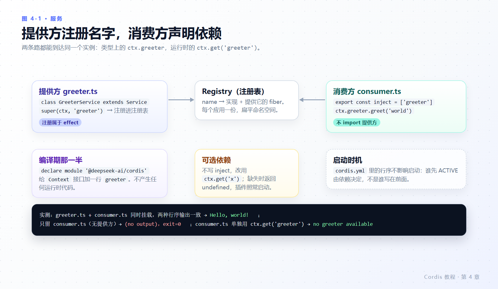
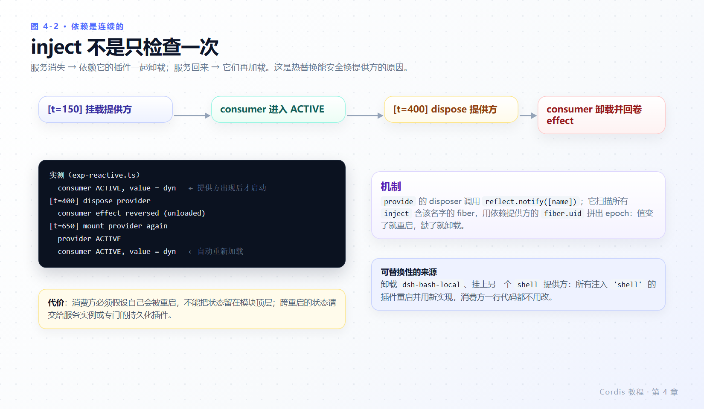

# 第 4 章 服务与 `inject`

> **本章目标**
>
> - 写一个 `Service` 子类，把能力以名字公开到 `ctx.<name>`。
> - 用 `inject` 声明依赖，理解“加载顺序由依赖决定，不由 YAML 行序决定”。
> - 明白 `inject` 是**持续跟踪**而非一次性启动检查，并能解释提供方消失/回来时发生了什么。
> - 会用 `ctx.get()` 做可选依赖，同时避开它的竞态陷阱。
> - 知道服务名的扁平命名空间和 harness 已占用的名字。
>
> **前置知识**：第 3 章（effect 与 fiber 状态）。
>
> **本章实验**：`greeter.ts`、`consumer.ts`、`optional.ts`、`exp-reactive.ts`。

---

## 4.1 服务回答的问题

**服务**是一个插件提供、其他插件通过 `ctx` 消费的具名能力。在 harness 中，`ctx.tools`、`ctx.llm`、`ctx.systemPrompt` 都是服务。

消费方只说“我要 `tools` 这个能力”，不 import 提供方。因此配置可以选择提供方，而消费方一行都不用改——这是第 3 章“可替换”承诺的落点。



*图 4-1 · 同一个实例有两条到达路径：编译期的 `ctx.greeter`（声明合并）与运行期的 `ctx.get('greeter')`（注册表查找）。*

---

## 4.2 提供服务

创建 `greeter.ts`：

```ts
import { Service, type Context } from '@deepseek-ai/cordis'

declare module '@deepseek-ai/cordis' {
  interface Context {
    greeter: GreeterService
  }
}

export class GreeterService extends Service {
  constructor(ctx: Context) {
    super(ctx, 'greeter')
  }

  greet(who: string) {
    return `Hello, ${who}!`
  }
}

export const name = 'greeter'

export function apply(ctx: Context) {
  ctx.plugin(GreeterService)
}
```

两部分协同工作：

- **运行时**：`super(ctx, 'greeter')` 以名字 `greeter` 注册该实例（`vendor/cordis/src/service.ts:42-57`，实际调用是 `self.ctx.reflect.provide(name, self, this[symbols.check])`）。此后任何插件都能通过 `ctx.greeter` 访问它。注册本身是 effect：卸载提供方时会移除该服务。
- **编译时**：`declare module '@deepseek-ai/cordis'` 用声明合并把 `greeter` 加进 `Context` 接口，使 `ctx.greeter` 在各处通过类型检查。它**不生成任何代码**；没有这段声明，服务在运行时照样工作，只是消费方失去类型安全。

构造器只有两个参数：`constructor(protected ctx: Context, name: string)`（`vendor/cordis/src/service.ts:42`）。名字也可以省下来，用静态 `provide` 兜底：`name ??= this.constructor['provide']`（`service.ts:43`）。本教程一律显式写名字，读诊断信息时更直接。

`Service` 子类本身就是插件（第 2 章的类形态），所以 `ctx.plugin(GreeterService)` 像挂载其他插件一样挂载它。

---

## 4.3 用 `inject` 消费服务

创建 `consumer.ts`：

```ts
import type { Context } from '@deepseek-ai/cordis'

export const name = 'consumer'
export const inject = ['greeter']

export function apply(ctx: Context) {
  console.log(ctx.greeter.greet('world'))
}
```

组合并运行：

```yaml
- name: './greeter.ts'
- name: './consumer.ts'
```

**实测**（退出码 0）：

```text
Hello, world!
```

`inject` 列出该插件需要的服务。Cordis 让插件保持 PENDING，直到列出的每项服务都存在，因此在 `apply` 内可以**保证** `ctx.greeter` 已就绪。

### 行序不重要，缺失才致命

交换 `cordis.yml` 两行顺序后重跑：

```yaml
- name: './consumer.ts'
- name: './greeter.ts'
```

**实测**：输出仍是 `Hello, world!`。决定启动时机的是依赖关系，不是文件里的位置。

彻底移除 `./greeter.ts`：

```yaml
- name: './consumer.ts'
```

**实测**：终端 `(no output)`，退出码 **0**。消费方停在 PENDING，不崩溃、不部分执行、不提示你在等什么。而且 PENDING 的 fiber 不保活事件循环，所以组合里没有别的运行项时，进程安静地以 0 退出。

这正是第 2 章那条排障纪律的另一半：新增配置项没效果时，除了拼写，还要查它的 `inject` 有没有提供方。[第 7 章 7.5 节](07-composition-and-hmr.md#75-诊断为什么我的插件没有输出)给出可执行的查法。

---

## 4.4 加载之后仍然跟踪依赖

`inject` 不是一次性的启动检查。应用运行期间，如果所需服务消失（提供方被卸载或被热替换），每个依赖它的插件也会随之卸载，并在服务恢复后再次加载。配合 effect（第 3 章），运行中的消费方不会保留对不可用服务的引用——依赖消失时，它自己的注册也一起撤销。

创建 `exp-reactive.ts` 把这条测出来：

```ts
import { Service, type Context } from '@deepseek-ai/cordis'

export const name = 'exp-reactive'

class DynService extends Service {
  constructor(ctx: Context) {
    super(ctx, 'dyn')
    console.log('  provider ACTIVE')
  }

  value() {
    return 'dyn'
  }
}

export function apply(ctx: Context) {
  ctx.plugin({
    name: 'consumer',
    inject: ['dyn'],
    apply(c: Context) {
      console.log('  consumer ACTIVE, value =', c.get('dyn')!.value())
      c.effect(() => () => console.log('  consumer effect reversed (unloaded)'))
    },
  })

  let provider: any
  const timeline: [number, () => void][] = [
    [150, () => { console.log('[t=150] mount provider'); provider = ctx.plugin(DynService) }],
    [400, () => { console.log('[t=400] dispose provider'); provider.dispose() }],
    [650, () => { console.log('[t=650] mount provider again'); provider = ctx.plugin(DynService) }],
    [900, () => { console.log('[t=900] exit'); process.exit(0) }],
  ]

  for (const [ms, fn] of timeline) setTimeout(fn, ms)
}
```

```yaml
- name: './exp-reactive.ts'
```

**实测**（退出码 0）：

```text
[t=150] mount provider
  provider ACTIVE
  consumer ACTIVE, value = dyn
[t=400] dispose provider
  consumer effect reversed (unloaded)
[t=650] mount provider again
  provider ACTIVE
  consumer ACTIVE, value = dyn
[t=900] exit
```



*图 4-2 · 提供方在 t=150 出现→消费方启动；t=400 消失→消费方卸载并回卷 effect；t=650 回来→消费方自动重新加载。*

机制（第 9 章会从源码完整走一遍）：`provide` 的 disposer 调用 `reflect.notify([name])`（`vendor/cordis/src/reflect.ts:297-303`）；`notify` 扫描所有 `inject` 含该名字的 fiber，用每个依赖提供方的 `fiber.uid` 拼出 epoch（`vendor/cordis/src/fiber.ts:611-639`）。依赖缺失 → epoch 记为 INACTIVE → 卸载；提供方重启 → uid 变 → 用新 epoch 重新加载。

这也是配置里可以安全替换服务的原因：卸载 `dsh-bash-local`，挂上另一个 `shell` 提供方，所有注入 `'shell'` 的插件都会重启并使用新实现。

**代价**：消费方必须假设自己会被重启。别把状态放在模块顶层变量里指望它长寿；需要跨重启存续的状态交给服务实例本身，或者专门的持久化插件。

---

## 4.5 可选依赖

`inject` 用于硬性依赖。功能缺失时插件仍可运行的话，就跳过 `inject`，在使用处探测。创建 `optional.ts`：

```ts
import type { Context } from '@deepseek-ai/cordis'

export const name = 'optional'

export function apply(ctx: Context) {
  // undefined when no provider is loaded; the plugin still runs.
  const greeter = ctx.get('greeter')
  console.log(greeter?.greet('maybe') ?? 'no greeter available')
}
```

单独挂它：

**实测**（`- name: './optional.ts'`）：

```text
no greeter available
```

现在同时挂提供方和它：

```yaml
- name: './greeter.ts'
- name: './optional.ts'
```

**实测**（连续跑三次，每次都是）：

```text
no greeter available
```

**这就是可选依赖的坑**：官方教程说“某项功能缺失时插件仍可运行”，但没提醒——因为配置项**并发启动**，`apply` 里那一刻 `ctx.get('greeter')` 很可能是 `undefined`，即使 `greeter.ts` 就在同一份 YAML 里。三次实测全部如此，不是偶发。

把它改成加 `inject`，同样的探测代码就有值了：

```yaml
- name: './greeter.ts'
- name: './optional-inject.ts'
```

```ts
export const inject = ['greeter']   // optional-inject.ts 其余同 optional.ts
```

**实测**：

```text
Hello, maybe!
```

三条选择：

| 需求 | 写法 | 语义 |
|---|---|---|
| 必须有，没有就等着 | `export const inject = ['x']` | PENDING 直到出现；出现后 `ctx.x` 保证可用 |
| 有则用，没有也能跑，且**要看到它** | `inject` + `ctx.x` | 同上，只是代码里按存在性分支 |
| 只是“顺手看一眼”，不关心是谁先跑 | `ctx.get('x')`，不写 `inject` | 拿到的是**调用那一刻**的快照；第 4.4 节的自动重启不会为你触发 |

`ctx.get(name, strict = true)` 的签名在 `vendor/cordis/src/reflect.ts:233`。需要“有就等、没有也算”的软依赖时，正确做法通常是：不 `inject`，但把探测放到某个稍后的动作里（事件回调、服务方法调用点），而不是放在 `apply` 的第一行。

---

## 4.6 命名

一个应用里的服务名称共用**一个扁平命名空间**。给自有服务加有辨识度的前缀或命名空间——harness 已经占用了 `tools`、`llm`、`systemPrompt`、`timer`、`loader`、`logger`、`registry` 这类普通名字。完整清单看 `docs/subsystems/core.zh.md` 上自动生成的 `cordis-surface` 区块。

两个后果值得提前知道：

- 名字撞车时，后注册的提供方会改变谁在 `ctx.<name>` 上；所有注入该名字的插件随之重启（4.4 节的机制）。第 7 章的 `isolate` 就是为“同一个名字、不同组各自一份”准备的。
- harness 侧还有一条同名规则：`ToolsService` 的注册对重复工具名会抛错，并提示“通过该 agent 的 `agent.ctx` 注册”（`packages/core/tools/src/index.ts:68-70`）。工具名与服务名是两个命名空间，但都容易撞。

---

## 4.7 本章小结

- 服务是具名能力：`super(ctx, 'name')` 注册（运行时），`declare module` 补类型（编译时），两者独立存在。
- `inject` 决定插件何时启动，YAML 行序不决定；提供方缺失时消费方停在 PENDING，静默且退出码 0。
- 依赖关系在加载后仍被持续跟踪：提供方消失 → 消费方卸载并回卷 effect；恢复 → 自动重启。因此配置可以安全替换实现。
- `ctx.get()` 适合探测，但不写 `inject` 时它读的是“此刻快照”，并发启动会让同一份 YAML 里的提供方看起来不存在（实测 3/3 次如此）。
- 服务名是全局扁平空间，请自带前缀；同名替换会触发所有注入方的重启。

### 检查点

1. 删掉 `declare module` 那段，`ctx.greeter` 还能在运行时用吗？会发生什么变化？
2. `cordis.yml` 里把 `./consumer.ts` 写在 `./greeter.ts` 前面，输出会变吗？
3. 你卸载了某个服务的提供方。注入它的插件此刻处于什么状态，它的监听器还在吗？
4. 你想“有 Redis 就用缓存，没有就走内存”，代码写在 `apply` 第一行用 `ctx.get('redis')`。为什么可能永远拿到 `undefined`？两种改法？

## 延伸阅读

- 官方：[服务](https://deepseek-harness.github.io/deepseek-harness/develop/cordis-tutorial/03-services)
- 仓库：`docs/cordis-tutorial/03-services.zh.md`、`docs/cordis-api/service.zh.md`、`docs/cordis-api/registry.zh.md`
- 服务隔离：`docs/user/develop/framework/service.zh.md#service-isolation`
- 源码：`vendor/cordis/src/service.ts:13-57`、`vendor/cordis/src/registry.ts:19-88, 176-185`、`vendor/cordis/src/reflect.ts:233, 277-303, 314-336`、`vendor/cordis/src/fiber.ts:611-639`
- 下一轮：[第 5 章 事件](05-events.md)，插件之间不共享引用也能通信。
