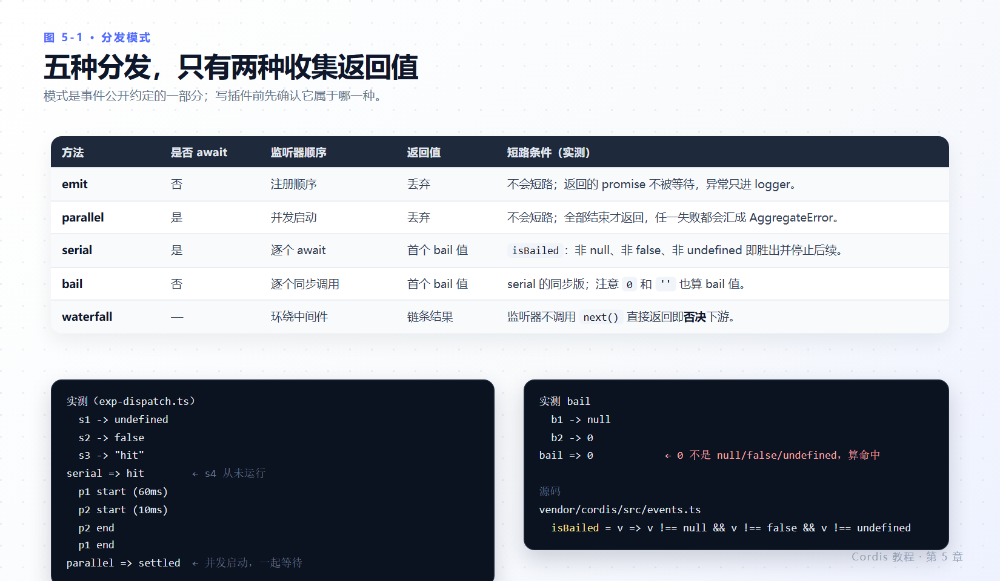
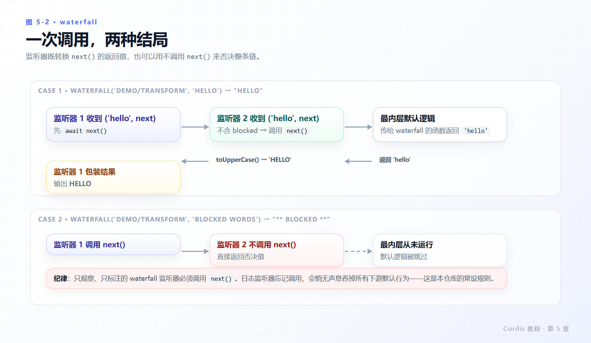

# 第 5 章 事件

> **本章目标**
>
> - 声明类型化事件，并让 `ctx.emit` 与 `ctx.on` 都获得完整类型。
> - 说清五种分发模式各自的语义：是否 await、是否收集返回值、能否互相短路。
> - 会读 `isBailed` 的准确定义，并知道 `0` 和 `''` 也算命中。
> - 掌握 waterfall 的 `next()` 契约与“否决”语义，记住那条常设纪律。
> - 知道模式是事件公开约定的一部分，写 harness 事件时要标 `@mode`。
>
> **前置知识**：第 4 章（服务与 `inject`）。
>
> **本章实验**：`stats.ts`、`reporter.ts`、`waterfall-demo.ts`、`exp-dispatch.ts`。

---

## 5.1 服务与事件的分工

服务支持**直接调用**：你知道要调 `ctx.greeter.greet()`，也需要它的返回值。事件让插件**发出通知**，而不需要知道有哪些插件正在监听、有几个在监听。

判断标准很简单：

| 你想要 | 用 |
|---|---|
| 拿到结果、执行能力 | 服务方法 |
| 让别人知道“发生了什么”，不关心谁在听 | `emit` / `parallel` |
| 让协作插件包装或回答一个决策 | `waterfall` |
| 问一圈“谁有答案”，第一个答的人赢 | `serial` / `bail` |

harness 用事件处理工具结果、模型请求和审批决定这类交互——第 8 章你会亲自观察到 `tools/result`。

---

## 5.2 声明、发出与监听

创建 `stats.ts`：一项负责计数、并在每次变化时发出通知的服务。

```ts
import { Service, type Context } from '@deepseek-ai/cordis'

declare module '@deepseek-ai/cordis' {
  interface Context {
    stats: StatsService
  }
  interface Events {
    'stats/report'(name: string, count: number): void
  }
}

export class StatsService extends Service {
  private counts = new Map<string, number>()

  constructor(ctx: Context) {
    super(ctx, 'stats')
  }

  bump(name: string) {
    const next = (this.counts.get(name) ?? 0) + 1
    this.counts.set(name, next)
    this.ctx.emit('stats/report', name, next)
  }
}

export const name = 'stats'

export function apply(ctx: Context) {
  ctx.plugin(StatsService)
}
```

`interface Events` 的合并与第 4 章的 `interface Context` 合并在事件系统里彼此对应：它声明事件名与监听器签名，因此 `ctx.emit` 和 `ctx.on` 都具有完整类型。`namespace/action` 命名约定让扁平的事件命名空间保持可读（`stats/report`、`tools/result`、`agent/pre-step`）。

创建 `reporter.ts`：

```ts
import type { Context } from '@deepseek-ai/cordis'
import type {} from './stats.ts'

export const name = 'reporter'
export const inject = ['stats']

export function apply(ctx: Context) {
  ctx.on('stats/report', (name, count) => {
    console.log(`[stats] ${name} -> ${count}`)
  })
  ctx.stats.bump('tool_call')
  ctx.stats.bump('tool_call')
  ctx.stats.bump('prompt')
}
```

`import type {} from './stats.ts'` 这一行运行时不导入任何东西，作用只是让 TypeScript 看见声明合并——`reporter.ts` 因此知道 `stats/report` 存在及其参数形状。

```yaml
- name: './stats.ts'
- name: './reporter.ts'
```

**实测**（退出码 0）：

```text
[stats] tool_call -> 1
[stats] tool_call -> 2
[stats] prompt -> 1
```

`emit` 是同步广播：`bump` 一调用，监听器立即执行，所以三条按调用顺序打印，`ctx.stats.bump` 本身不返回任何东西。

### 监听器的三个细节

签名在 `vendor/cordis/src/events.ts:97`（`on`）与 `:106`（`once`）：

```ts
on<K extends keyof Events>(name: K, listener: Events[K], options?: boolean | EventOptions): () => boolean
once<K extends keyof Events>(name: K, listener: Events[K], options?: boolean | EventOptions): () => boolean
```

1. **`ctx.on()` 属于 effect**：监听器随插件一同消失，你绝不需要手动维护 `removeListener`。
2. **返回值是 disposer**，`() => boolean`：调用它移除监听器，若此前仍在注册表中则返回 `true`。需要临时挂钩时可以直接保存它。
3. **`options` 可以是布尔**，等价于 `{ prepend: true }`。`EventOptions` 只有两个字段（`vendor/cordis/src/events.ts:112-117`）：`prepend`（排到已有监听器之前）和 `global`（跳过上下文过滤检查）。`once` 的监听器在第一次调用后自行 dispose。

官方教程还留了一条判断：仅当监听器**必须**在普通注册之前运行时才用 `prepend`（`docs/cordis-primer.zh.md` 的 waterfall 语义节）。默认注册顺序就是你挂载的顺序。

---

## 5.3 五种分发模式

`emit` 只是五种模式之一。**事件采用哪种模式是其约定的一部分**，它决定了监听器能否返回值、能否并发运行，以及能否彼此短路。



*图 5-1 · 只有 serial/bail/waterfall 收集返回值；只有 waterfall 能被逐个监听器短路整条链。*

| 模式 | 调用 | 是否 await | 语义 |
|---|---|---|---|
| emit | `ctx.emit(name, ...args)` | 否 | 同步广播；不等待也不收集返回的 promise 与值 |
| parallel | `await ctx.parallel(name, ...args)` | 是 | 所有监听器并发运行并一起等待 |
| serial | `await ctx.serial(name, ...args)` | 是 | 按顺序逐个 await；第一个非 `null`/`false`/`undefined` 返回值胜出并停止后续 |
| bail | `ctx.bail(name, ...args)` | 否 | serial 的同步版本 |
| waterfall | `ctx.waterfall(name, ...args, next)` | 取决于监听器 | 环绕中间件；见 5.4 |

### 把边界测出来

`isBailed` 的准确定义只有一行（`vendor/cordis/src/events.ts:13-15`）：

```ts
return value !== null && value !== false && value !== undefined
```

创建 `exp-dispatch.ts`，同一种事件挂四个监听器，分别返回 `undefined` / `false` / `'hit'` / `'never'`；另一个事件挂两个并发监听器（60 ms 和 10 ms）；第三个用 `bail` 测 `null` 与 `0`。

```yaml
- name: './exp-dispatch.ts'
```

**实测**（退出码 0）：

```text
  s1 -> undefined
  s2 -> false
  s3 -> "hit"
serial => hit
  p1 start (60ms)
  p2 start (10ms)
  p2 end
  p1 end
parallel => settled
  b1 -> null
  b2 -> 0
bail => 0
```

三点从输出里直接读出来：

- `serial` 按注册顺序执行，`s3` 命中后 `s4` **从未运行**，整体返回 `'hit'`。
- `parallel` 两个监听器**同时启动**（先 p1 后 p2，按注册顺序），但 `p2` 先结束；`await ctx.parallel(...)` 直到两者都结束才返回。失败会聚合为 `AggregateError`（`vendor/cordis/src/events.ts:183-187`）。
- `bail` 返回 `0`：`0` 既不是 `null`、也不是 `false`、也不是 `undefined`，所以**它是命中值**。用“假值”表达“我没有意见”是错的——要说没有意见就返回 `undefined`（或 `null`/`false`）。

对应实现都在 `vendor/cordis/src/events.ts`：`serial` 在 `:204-209`，`bail` 在 `:217-222`，`emit` 在 `:194-196`。

### `emit` 不返回错误，但会**抛**错误

“同步广播、不等待返回值”容易被读成“和调用方隔离”。实测否掉了这个读法：在一个 `emit` 事件的监听器里 `throw`：

```ts
ctx.on('demo/boom', () => { throw new Error('listener blew up (emit)') })
try {
  ctx.emit('demo/boom', 1)
  console.log('C: emit 返回了，调用方没看到异常')
} catch (error) {
  console.log('C emit 监听器抛错:', error.message)
}
```

**实测**（`exp-errors.ts`）：

```text
C emit 监听器抛错: name=Error code=- message="listener blew up (emit)"
```

`emit 返回了` 那一行没有打印——异常同步传播回发出方。`parallel` 则把拒绝聚合成 `AggregateError`（`vendor/cordis/src/events.ts:183-187`，实测 `name=AggregateError`、`message` 为空）。

所以：**观察型监听器要自带 `try/catch`**。harness 的 `tools/result` 之所以可以放心挂观察者，是发射点替你做了一层——观察者失败被捕获并交给 logger，永不外泄（`packages/core/tools/src/pipeline.ts:399-419`）。那是提供方的责任，不是 `emit` 的默认行为。


每个 harness 事件都会在自己的子系统页面（仓库 `docs/subsystems/core.zh.md`）自动生成的参考里记录其模式，靠的是声明上的 `@mode` 标签——生成目录会把声明与分发调用点交叉校验。例如 `tools/result` 标注为 `@mode emit`（`packages/core/tools/src/events.ts:42-49`），它的兄弟事件 `tools/pre-execute` / `tools/execute` / `tools/post-execute` 全是 `waterfall`。

---

## 5.4 waterfall：转换或短路

waterfall 是实现**拦截**的模式。每个监听器都会收到参数和一个 `next()` continuation：它可以转换 `next()` 的返回值，也可以不调用 `next()` 而直接返回，从而短路链条其余部分。Cordis 文档把后一种行为称为**否决**。

创建 `waterfall-demo.ts`：

```ts
import type { Context } from '@deepseek-ai/cordis'

declare module '@deepseek-ai/cordis' {
  interface Events {
    'demo/transform'(input: string, next: () => Promise<string>): Promise<string>
  }
}

export const name = 'waterfall-demo'

export function apply(ctx: Context) {
  // Listener 1: wrap the downstream result.
  ctx.on('demo/transform', async (input, next) => {
    const downstream = await next()
    return downstream.toUpperCase()
  })

  // Listener 2: short-circuit when it owns the decision.
  ctx.on('demo/transform', async (input, next) => {
    if (input.includes('blocked')) return '** blocked **'
    return next()
  })

  void (async () => {
    console.log(await ctx.waterfall('demo/transform', 'hello', async () => 'hello'))
    console.log(await ctx.waterfall('demo/transform', 'blocked words', async () => 'blocked words'))
  })()
}
```

```yaml
- name: './waterfall-demo.ts'
```

**实测**（退出码 0）：

```text
HELLO
** BLOCKED **
```



*图 5-2 · 上行是转换，下行是不调用 `next()` 的否决；注意第二行里最内层默认逻辑从未运行。*

按顺序看第二行是怎么产生的：

1. 监听器 1 先运行，它调用 `next()`；
2. `next()` 调用监听器 2；
3. 监听器 2 看到 `blocked`，**直接返回而不调用 `next()`** —— 于是传给 `ctx.waterfall` 的最内层默认逻辑从未运行；
4. 返回途中，监听器 1 拿到 `'** blocked **'`，把它转成大写。

实现只有几行，值得读一遍（`vendor/cordis/src/events.ts:234-243`）：

```ts
waterfall(...args) {
  const cbs = this.dispatch('waterfall', args)
  const inner = args.pop()
  const next = () => { const cb = cbs.shift() ?? inner; return cb(...args) }
  args.push(next)
  return next()
}
```

最后一个参数是**最内层**（默认行为），Cordis 把它弹出来，再往参数尾部压入一个 `next()`。链条从最外层监听器开始；每个监听器自己决定是调用 `next()` 还是接管结果。

由此得到本仓库的常设纪律（`docs/cordis-primer.zh.md#cordis-waterfall-semantics`）：

> **只负责观察或标注的 waterfall 监听器必须调用 `next()`。** 不调用就直接返回，代表你有意短路整条链。一个忘记调用 `next()` 的日志监听器，会悄无声息地吞掉所有下游默认行为。

harness 里 waterfall 用于协作插件可以包装或回答的决策：`agent/pre-step` 允许插件拒绝拟议步骤或替换其输入，`approval/request` 允许策略代替用户作答。写这类监听器之前，先确认你是在“标注”还是在“接管”。

---

## 5.5 本章小结

- 事件让发出方不知道监听者是谁；`interface Events` 的声明合并给 `emit`/`on` 完整类型，`namespace/action` 保持扁平命名空间可读。
- `ctx.on` 是 effect，返回 `() => boolean` 的 disposer；`once` 触发后自行 dispose；`EventOptions` 只有 `prepend` 与 `global`。
- 五种模式只有 serial / bail / waterfall 收集返回值；`isBailed` 是“非 null、非 false、非 undefined”，`0` 与 `''` 都会命中。
- waterfall 是环绕中间件：最后一个参数是最内层默认逻辑，不调用 `next()` 即**否决**下游。
- 模式属于事件的公开约定；harness 事件用 `@mode` 标注并被生成目录交叉校验。

### 检查点

1. `reporter.ts` 为什么要写 `import type {} from './stats.ts'`？删掉它运行时和编译时分别怎样？
2. 你想让一个监听器“在所有普通监听器之前跑”，还想让它只跑一次。两个 API 怎么组合？
3. `serial` 的监听器返回 `0` 表示什么？想表达“我没意见”该返回什么？
4. 你要给 `agent/pre-step` 加一个记录日志的监听器。必须做到哪一点才不改变行为？

## 延伸阅读

- 官方：[事件](https://deepseek-harness.github.io/deepseek-harness/develop/cordis-tutorial/04-events)
- 仓库：`docs/cordis-tutorial/04-events.zh.md`、`docs/cordis-primer.zh.md`（分发模式表与 waterfall 语义）、`docs/cordis-api/events.zh.md`
- 生产者/消费者视角：`docs/event-producer-consumer.zh.md`
- 源码：`vendor/cordis/src/events.ts:13-15, 97-117, 172-173, 183-243`、`packages/core/tools/src/events.ts:18-56`
- 下一轮：[第 6 章 配置](06-config.md)，`apply` 的第二个参数从哪来。
