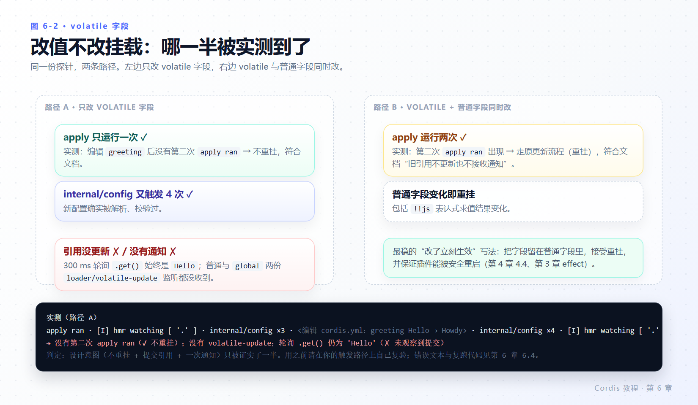

# 第 6 章 配置

> **本章目标**
>
> - 给插件声明配置 schema，并在 `apply(ctx, config)` 里拿到**已校验、已补默认值**的对象。
> - 知道配置错误的真实归宿：fiber 进入 FAILED，消息进 logger，终端可能什么都不显示。
> - 用 `!!js` 在加载时求值，并分清它能出现在哪两个位置。
> - 理解 volatile 字段解决什么问题，并知道本章实测中**哪一部分复现了、哪一部分没有**。
> - 分得清 Schemastery 与 Standard Schema 的关系。
>
> **前置知识**：第 2 章（静默失败与 buffer 回读）、第 3 章（FAILED 状态）。
>
> **本章实验**：`config-demo.ts`、`volatile-demo2.ts`。

---

## 6.1 可配置插件

`cordis.yml` 中每个配置项都可以携带 `config` 块；插件声明一个 schema，Cordis 在运行 `apply` 前用它验证这个块。**配置有错就不会启动插件**——不存在“配置不完整但插件照跑”的中间态。

创建 `config-demo.ts`：

```ts
import type { Context } from '@deepseek-ai/cordis'
import Schema from '@deepseek-ai/schemastery'

export const name = 'config-demo'

export interface Config {
  greeting: string
  targets: string[]
}

export const Config: Schema<Config> = Schema.object({
  greeting: Schema.string().default('Hello'),
  targets: Schema.array(String).default(['world']),
})

export function apply(ctx: Context, config: Config) {
  for (const target of config.targets) {
    console.log(`${config.greeting}, ${target}!`)
  }
}
```

导出的 `Config` 同时是 TypeScript 接口和同名运行时 schema：消费方获得类型，Cordis 获得校验器。

关于 schema 库的一条重要边界（官方教程已经点明，这里给源码位置）：插件元数据接受的是 **Standard Schema** 校验器（`vendor/cordis/src/registry.ts:100-111` 的 `Config?: StandardSchemaV1`）。本仓库用 [Schemastery](https://github.com/shigma/schemastery) 定义 schema，而 Cordis 本身接受任何 Standard Schema 兼容验证器。**因此把普通对象导出成 `Config` 不工作**——普通对象不是校验器，会走 `unwrapExports` 的普通导出路径，被当成一个插件形态错误（第 2 章 2.4）。

```yaml
- id: demo
  name: './config-demo.ts'
  config:
    targets: ['alpha', 'beta']
```

**实测**（退出码 0）：

```text
Hello, alpha!
Hello, beta!
```

省略 `config` 时，schema 默认值补齐：

```yaml
- id: demo
  name: './config-demo.ts'
```

**实测**：

```text
Hello, world!
```

`apply` 始终收到**完整且经过验证**的配置。这也是 `config` 在类型上可以不带 `?` 的原因。

---

## 6.2 明确报错——以及报错在哪儿

传无效内容：

```yaml
- id: demo
  name: './config-demo.ts'
  config:
    targets: 'not-an-array'
```

**实测（终端直接看）**：`(no output)`，退出码 **0**。

官方教程[第 5 章](https://deepseek-harness.github.io/deepseek-harness/develop/cordis-tutorial/05-config)写的是：

```text
ValidationError: invalid config:
  - $.targets expected array but got not-an-array (at targets)
```

并说“本教程的启动器打印错误后以状态码 1 退出”。**在当前检出版本上两句话都不成立**，原因与第 2 章实验 A 完全相同：加载期异常在 `vendor/cordis/src/fiber.ts:686-691` 被捕获后交给 `ctx.logger.error(reason)`，插件 fiber 进入 FAILED，进程不崩。

把第 2 章的 `log-replay.ts` 挂上，官方那句文本一字不差地出来了：

```yaml
- id: demo
  name: './config-demo.ts'
  config:
    targets: 'not-an-array'
- name: './log-replay.ts'
```

**实测**（退出码 0）：

```text
buffered messages: 1
  [error] config-demo — ValidationError: invalid config:
  - $.targets expected array but got not-an-array (at targets)
```

于是这条更值得记：

> 配置校验失败**一定**发生，错误文本**一定**存在（就在 `ctx.logger.buffer` 里），但默认启动器**不会**把它打到终端，也不会以非 0 退出。看错误要靠 buffer 回读，或把 logger-console 挂在启动早期之后仍活跃的时机。


*图 6-1 · `config` 块 → schema 解析/校验（`internal/config` 钩子）→ 通过则 `apply(ctx, config)`，失败则 fiber=FAILED + 一条 logger 错误。*

官方教程还补了一句设计意图：如果某个插件的配置通过了 schema，但其中指定的资源或提供方不可用，该插件也应当在**能解析该引用时立即拒绝**。也就是说，schema 只保证形状，不保证语义可用；语义检查是你自己在 `apply` 或服务的 `[Service.check]` 里做的。

---

## 6.3 计算得到的配置值：`!!js`

本仓库使用的 loader 支持 `!!js` 标签，用于必须在加载时计算的配置值：

```yaml
- id: demo
  name: './config-demo.ts'
  config:
    greeting: !!js process.env.DEMO_GREETING ?? 'Hello'
    targets: ['gamma']
```

```sh
DEMO_GREETING=Salve node --import tsx ../../vendor/cordis/bin.js
```

**实测**（退出码 0）：

```text
Salve, gamma!
```

`!!js` 只在两个位置有效：

| 位置 | 求值时机 | 上下文 |
|---|---|---|
| 条目的 `config` | 该插件的 inject 激活之后，随配置解析 | 该插件自己的上下文（`ctx.serviceName` 可用） |
| 条目的 `disabled` | 每次挂载决策时 | loader 上下文 |

其余元数据（`name`、`id`、`inject` 等）保持静态字面值，写在里面的表达式只是普通真值数据（`vendor/loader/src/config/entry.ts:91-95`、`vendor/loader/src/config/utils.ts:5-9`，实现是 `with (ctx) { eval(expr) }`）。Include 会保留嵌套行的表达式，直到目标行激活（`docs/cordis-primer.zh.md#loader-configuration`）。

真实用法看 harness 的 base 层：`packages/bundle/base/cordis.patch.yml:22` 用 `disabled: !!js "!ctx.get('profileContext')"` 按上下文门控整行。按环境选择插件时，也请用 overlay 而不是把 `!!js` 塞进 `name`。

> **与官方文档的差异：`!!js` 不是本仓库的扩展**
>
> 官方中文教程称 `!!js` 是“（本仓库的扩展）”。实测代码里两边都有：
> - 上游 `cordis/packages/include/src/index.ts:20-29, 33` 定义了同一个 `tag:yaml.org,2002:js` 标量标签，产出 `{ __jsExpr: source }`（`customTags: [JsExpr]`）；求值在 `cordis/packages/loader/src/config/utils.ts:21-35, 99`。
> - vendor 副本 `vendor/include/src/index.ts:9-15` 用 js-yaml 实现了等价标签，`vendor/loader/src/config/utils.ts` 同样有 `__jsExpr` 求值。
>
> 真正**属于本仓库**的是这些周边：`entryListSchema` 的导出（供 `dsh --dump-config` 复用，`vendor/include/src/index.ts:23`）、`applyEntryPatches` 这套补丁操作（`vendor/include/src/index.ts:57-127`），以及上游较新的 `journal.ts` / `SourceLocation` 源位置特性在 vendor 副本中缺席。结论：`!!js` 可以按 cordis 通用能力来学，抄配置时只要包名前缀用对（第 1 章 1.4）就行。

---

## 6.4 Volatile 字段

对于插件在**每次操作中读取**的字段，可以用 `.volatile()`。设计目标：字段变化时更新稳定引用，无需重新挂载插件。读取方式是 `.get()`：

```ts
import type { Context } from '@deepseek-ai/cordis'
import type {} from '@deepseek-ai/cordis-plugin-loader'
import Schema from '@deepseek-ai/schemastery'

export const name = 'volatile-demo'

export const Config = Schema.object({
  greeting: Schema.string().default('Hello').volatile(),
})

export function apply(ctx: Context, config: ReturnType<typeof Config>) {
  ctx.on('loader/volatile-update', (paths) => {
    console.log(config.greeting.get())
  })
}
```

规则清单（`docs/cordis-tutorial/05-config.zh.md:91-95`，与 vendor 源码一致）：

- 直接调用 `Config(raw)` 也返回引用；**没有默认值的可选字段同样有引用**，字段缺省时 `.get()` 返回 `undefined`。
- 可以保存引用，也可以在单次操作中保存读取值——**包括跨越 `await`**——但不能把该值用于后续操作。
- 对象和数组值是脱离输入、递归冻结的普通数据快照；函数、类实例和循环引用会被拒绝。
- volatile 字段必须声明在**固定对象路径**上，或者把整个对象/数组标记为 volatile。**数组、字典、union 或 intersect 分支、lazy、transform 或另一个 volatile 值内部的独立引用会被拒绝。**
- Loader 比较原始配置时**忽略** schema 声明的 volatile 字段；仅 volatile 变化时经目标插件的 `internal/config` 钩子解析并校验，若所有普通字段的有效值仍然一致，就把新值提交到运行中的引用，并向所属实例发出一次 `loader/volatile-update`（参数是变化路径的数组），**不进入**目标插件的 `internal/update`。等值更新不通知。无效候选会被记录日志，运行中的引用保持不变，直到下次激活。通知使用普通 `emit`，不等待资源重新配置完成。
- 普通字段有效值变化（包括表达式求值结果变化），或普通字段与 volatile 同时变化时，沿用原更新流程（重挂）；旧引用不更新也不接收通知。
- `fiber.update()`、代码替换和依赖替换保留原有生命周期；Group/Include 仍分发子条目更新。
- 配置文件保存普通值；`simplify()` 会解包引用。序列化 schema 保留字段类型、默认值、角色和 volatile 标记，供基于 schema 的表单使用。

最后一条拒绝规则可以实测出来。把 volatile 放进数组分支内部：

```ts
export const Config = Schema.object({
  targets: Schema.array(Schema.string().volatile()).default([]),
})
```

**实测**（配 `log-replay.ts`，退出码 0）：

```text
buffered messages: 1
  [error] volatile-bad — ValidationError: invalid config:
  - $.targets.* volatile fields require a fixed object path without an enclosing volatile field (at targets.*)
```

### 本章测到了什么，没测到什么

这一点必须写清楚，因为它决定你在真实项目里能不能依赖 volatile 语义。实验设置：`logger-console` + `timer` + `dsh-hmr`（`root: ['.']`）+ 带 `id: vol` 的 `./volatile-demo2.ts`（`greeting` 声明为 volatile，`suffix` 普通）。探针同时做三件事：注册 `loader/volatile-update` 监听（普通 + `global` 各一份）、注册 `internal/config` 监听、每 300 ms 轮询 `config.greeting.get()`。

**实验一：只改 volatile 字段（`Hello` → `Howdy`）**

```text
apply ran
  internal/config fired
  internal/config fired
  internal/config fired
2026-10-30 12:52:34 [I] hmr watching [ '.' ]
  internal/config fired          ← 编辑发生在这一组之前
  internal/config fired
  internal/config fired
  internal/config fired
2026-10-30 12:52:35 [I] hmr watching [ '.' ]
```

**实验二：volatile 与普通字段同时改**

```text
apply ran
  internal/config fired ×3
2026-10-30 12:52:38 [I] hmr watching [ '.' ]
  internal/config fired
apply ran                        ← 重新挂载
  internal/config fired ×3
2026-10-30 12:52:39 [I] hmr watching [ '.' ]
```

对得上与对不上的部分：

| 官方语义 | 本机实测 | 判定 |
|---|---|---|
| volatile-only 变化不重挂插件 | `apply ran` 只出现一次 | **复现** |
| 普通字段变化沿用原更新流程（重挂） | 第二次运行里 `apply ran` 出现两次 | **复现** |
| 新配置经目标插件的 `internal/config` 解析校验 | 编辑后 `internal/config` 又触发 4 次 | **复现** |
| 把新值提交到运行中的引用 | 300 ms 轮询 3 秒，`.get()` 始终 `Hello` | **未复现** |
| 发出一次 `loader/volatile-update` | 普通与 `global` 两份监听都没收到 | **未复现** |

结论要老实写：**在这条由 HMR 触发 Include 刷新、且配置项带 `id` 的路径上，本机能证明“不重挂”，但没能证明“引用被更新且发了通知”。** 已知线索是 `internal/config` 确实跑了（说明新版本配置被解析并校验），而“提交到运行中的引用”那一步（`vendor/loader/src/config/entry.ts:160-197` 的 `updateVolatile` + `emit(self, 'loader/volatile-update', paths)`）没有作用在插件 `apply` 闭包持有的那批引用上。是否属于该路径未覆盖、还是引用身份在刷新时换了，本教程没有继续追——需要读 `Entry.update` 与 Include `refresh()` 的调用图，超出本章范围。

给你的实操建议：**不要把“配置改了立刻生效”当成 volatile 的既定保证。** 需要热生效的字段，走第 7 章的重挂路径（普通字段）最稳；确实要用 volatile，请在你的实际触发路径（直接 `fiber.update()`、Group 子条目更新、还是 Include 刷新）里自己复验一次，用上面的探针代码，五分钟就能判。



*图 6-2 · 左：只有 volatile 变化 → 不重挂（实测）；右：普通字段变化 → 重挂（实测）。中间的“引用提交 + 一次通知”是本章唯一没能实测到的环节。*

---

## 6.5 本章小结

- 配置项带 `config`，插件带 schema；`apply(ctx, config)` 收到的是已校验、已补默认值的对象。schema 必须是 Standard Schema 兼容校验器（本仓库用 Schemastery），普通对象不行。
- 校验失败 → fiber FAILED + 一条 logger 错误；在当前版本**不打印、不以 1 退出**（官方教程的这两句已过时）。用 `log-replay` 回读 `ctx.logger.buffer` 可以看到完整错误文本。
- `!!js` 在 `config` 与 `disabled` 两处有效，分别在插件配置解析时和每次挂载决策时求值；它是 cordis 的通用能力，不是本仓库独有。
- volatile 的设计是“改值不改挂载”。本机实测确认了“不重挂”一侧，未能确认“运行中引用被更新 + 一次 `loader/volatile-update`”一侧；用前请复验。
- volatile 只能声明在固定对象路径上；数组/union/transform 内部的独立引用会被 schema 直接拒绝，错误文本可实测。

### 检查点

1. 导出 `export const Config = { greeting: String }`（普通对象）会发生什么？为什么？
2. 你改了 `config.targets`（普通字段）并保存，插件被重挂。volatile 语义下哪种改动不会重挂？
3. 终端空、退出码 0，你怀疑配置校验失败。给出确切的两步排查。
4. `disabled: !!js ...` 和 `config: !!js ...` 的求值上下文有什么不同？求值时机呢？

## 延伸阅读

- 官方：[配置](https://deepseek-harness.github.io/deepseek-harness/develop/cordis-tutorial/05-config)
- 仓库：`docs/cordis-tutorial/05-config.zh.md`（volatile 段是官方最完整的描述）、`docs/cordis-primer.zh.md#loader-configuration`
- 相关 ADR/说明：`docs/config-catalog.zh.md`（settings 侧消费者）、`.agents/notes/implemented/architecture/2026-09-18-volatile-config-references.md`
- 源码：`vendor/cordis/src/registry.ts:100-111`、`vendor/cordis/src/fiber.ts:686-691`、`vendor/loader/src/config/entry.ts:91-95, 130-197`、`vendor/loader/src/config/utils.ts:5-9, 25-31`、`vendor/include/src/index.ts:9-15, 52-133`、`cordis/packages/include/src/index.ts:20-29, 33`
- 下一轮：[第 7 章 组合与热重载](07-composition-and-hmr.md)，`config` 之外的配置项元数据。
