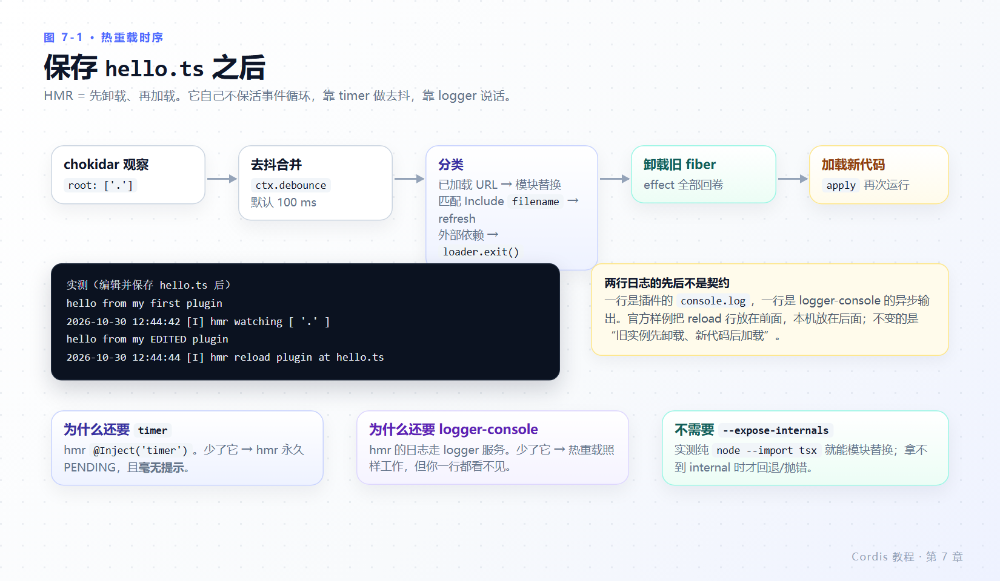
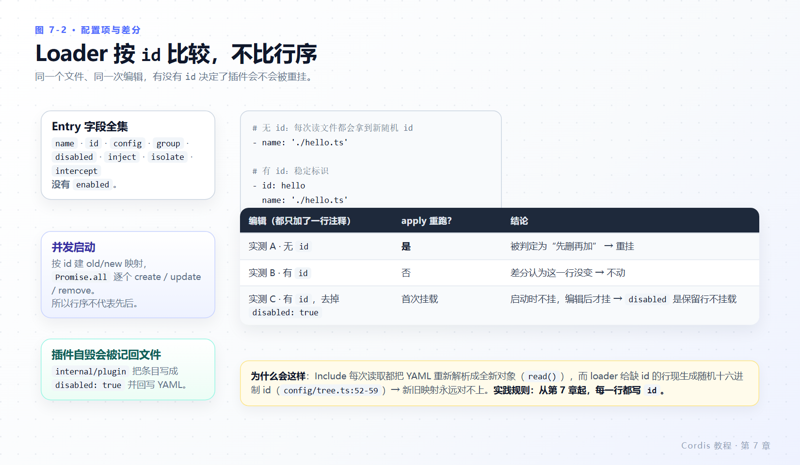
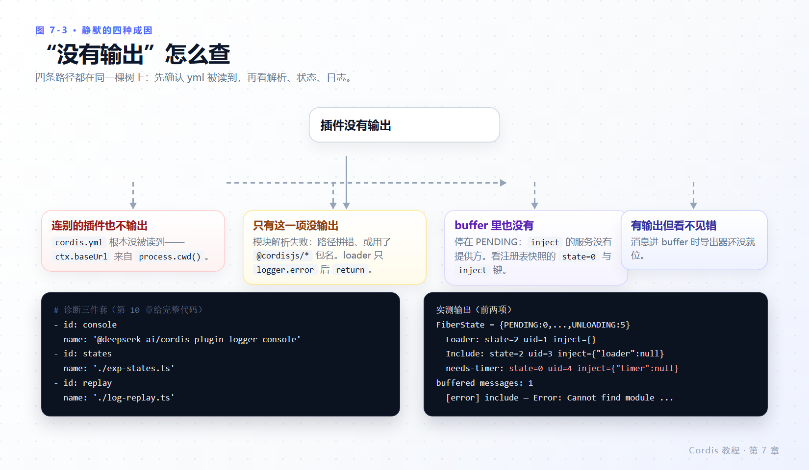

# 第 7 章 组合与热重载

> **本章目标**
>
> - 读全一个 Cordis 配置项支持的元数据字段，并知道每个字段影响的是挂载、标识还是隔离。
> - 挂上 HMR，理解它为什么还需要 logger 和 timer 两个辅助插件。
> - 用 `id` 控制配置项在编辑时是否被重挂（本章给三组实测对照）。
> - 建立诊断 PENDING 的可执行流程，不再靠猜。
> - 知道 `group` 与 `isolate` 解决什么问题。
>
> **前置知识**：第 3 章（fiber 状态与 effect）、第 4 章（`inject`）。
>
> **本章实验**：`hello.ts`、`greeter.ts`、`consumer.ts`、`needs-timer.ts`、`diagnose.ts` + `@deepseek-ai/dsh-hmr`。

---

## 7.1 一个配置项不只 `name`

到目前为止每一项都是 `- name: './xxx.ts'`。完整的字段集合在 `vendor/loader/src/config/entry.ts:10-23`：

| 字段 | 作用 | 影响 |
|---|---|---|
| `name` | 模块指定符：相对路径、NPM 包名，或 `cordis:` / internal 前缀 | 解析与导入 |
| `id` | 该配置项的稳定标识 | 差分：修改 vs 先删再加 |
| `config` | 传给插件的配置对象（第 6 章） | 校验与重挂 |
| `disabled` | 保留配置项但不挂载；`!!js` 时按上下文求值 | 挂载决策 |
| `group` | 标记这是一组，可嵌套配置项子列表 | 作为一个单元加载/卸载 |
| `inject` | 在配置层面声明依赖 | 激活时机 |
| `isolate` | 为本组就某服务名提供独立实例 | 服务隔离（`vendor/loader/src/config/isolate.ts:5-14`） |
| `intercept` | 拦截某服务的配置合并 | 同上模块 |

没有 `enabled` 字段——只有 `disabled`；组本身永远是 enabled 的（`entry.ts:76-85` 的注释与实现）。`disabled` 会被后代继承。

`group` 嵌套一个子列表，写法是把子列表放进 `config`：

```yaml
- name: './hello.ts'
- group: true
  config:
    - name: './greeter.ts'
    - name: './consumer.ts'
      disabled: true
```

**实测**（退出码 0）：

```text
hello from my first plugin
```

三个信息一次拿到：`./hello.ts` 正常挂载；组里的 `greeter.ts` 也挂载了（无输出属正常，它本来只注册服务）；`consumer.ts` 因为 `disabled: true` 被跳过——否则它会打印 `Hello, world!`。

`isolate` 的用途：两个组可以各自看到配置不同的 `shell` 提供方，互不影响。机制是 `isolate: { <serviceName>: true | "label" }`——`true` 给该配置项一个私有 realm（符号后缀 `#<id>`），字符串则按 label 共享一个全局 realm（后缀 `@<label>`），切换由 `loader/patch-context` 这个 waterfall 事件完成（`vendor/loader/src/config/isolate.ts:49-153`）。本章不展开实验，细节见 `docs/user/develop/framework/service.zh.md#service-isolation`。

---

## 7.2 配置项是并发启动的

Loader 对一组配置项做差分后，用 `await Promise.all(...)` 并发地 create / update / remove（`vendor/loader/src/config/group.ts:48-65`）。这解释了你在第 2、4 章反复看到的现象：

- 行序不决定谁先 `apply`；
- 不写 `inject` 的 `ctx.get()` 读到的是竞态快照（第 4 章 4.5）；
- 启动阶段记录的日志，可能没有任何导出器在场（第 2 章 2.5）。

---

## 7.3 热模块替换（HMR）

卸载会释放 effect（第 3 章），加载会遵循依赖（第 4 章），因此 HMR 只需要“先卸载、再加载”就能替换正在运行的插件。本仓库的实现是 `@deepseek-ai/dsh-hmr`（源码 `packages/boot/hmr`）。

在 `tmp/cordis-tutorial` 里写 `cordis.yml`：

```yaml
- id: logger
  name: '@deepseek-ai/cordis-plugin-logger-console'
- id: timer
  name: '@deepseek-ai/cordis-plugin-timer'
- id: hmr
  name: '@deepseek-ai/dsh-hmr'
  config:
    root: ['.']
- id: hello
  name: './hello.ts'
```

```sh
node --import tsx ../../vendor/cordis/bin.js
```

**实测**（编辑 `hello.ts` 把日志文本改成 `hello from my EDITED plugin` 并保存；进程用 SIGKILL 停止）：

```text
hello from my first plugin
2026-10-30 12:44:42 [I] hmr watching [ '.' ]
hello from my EDITED plugin
2026-10-30 12:44:44 [I] hmr reload plugin at hello.ts
```



*图 7-1 · watcher → debounce → 按 `id` 差分 → 卸载旧 fiber（effect 回卷）→ 用新代码重新加载 → `apply` 再次运行。*

官方样例里 `reload plugin at hello.ts` 出现在新输出**之前**；本机实测出现在**之后**。两行日志一行来自 `console.log`（插件自己），一行来自 logger-console（异步格式化后写出），先后顺序不是契约。可复现的事实是：旧实例先卸载（它的所有 effect 被回卷），新代码随后加载，`apply` 再次运行。

按 Ctrl-C 停止进程。编辑 `cordis.yml` 本身也会触发更新（7.4 节）。

### 为什么还要 logger 和 timer

这两行不是装饰：

- **`hmr` 通过 Cordis 的 logger 服务记录日志**（`packages/boot/hmr/src/index.ts:413-415, 702-710`）。没有控制台导出器时，只有根 logger 的内存 buffer 在收消息，你一行都看不到——第 2 章实验 A 的同一个机制。
- **`hmr` `inject` 了 `timer`**（`@Inject('loader')` + `@Inject('timer')`，`packages/boot/hmr/src/index.ts:211-212`）。它用 `ctx.debounce(...)` 批量合并文件事件（`:437-478`），而 `debounce` 是 `@deepseek-ai/cordis-plugin-timer` 混入到每个上下文上的方法（`vendor/timer/src/index.ts:12-16`）。没有 timer，`hmr` 会永远停在 PENDING，而且**不发出任何提示**（第 4 章 4.3）。

顺带一条常见困惑：`hmr` 的配置字段是扁平的——`base`、`root`（默认 `['.']`）、`ignored`（默认 `**/node_modules`、`**/.*`、`cache`、`data`）、`debounce`（默认 100 ms），见 `packages/boot/hmr/src/index.ts:215-225`。上游 `@cordisjs/plugin-hmr` 用的是 `watch.root` / `watch.debounce` 这类嵌套写法，别抄错。

### 要不要 `--expose-internals`

`hmr` 通过 Loader 读取 Node 的 loader 内部结构来做模块替换（`packages/boot/hmr/src/index.ts:310-313`：拿不到 `ctx.loader.internal` 时抛 `--expose-internals is required for HMR service`）。**实测在纯 `node --import tsx` 下不需要该 flag**，模块替换正常发生（上面那次运行就是证据）；Loader 在没有 `--expose-internals` 时会退回可选的 `node-addon-require-builtin`（`vendor/loader/src/internal.ts:108-118, 131-143`）。官方教程那句“请在 tsx 下运行 Cordis”是正确要求，但容易让人误以为还要额外 flag——不需要。

---

## 7.4 `id` 决定编辑配置时会不会被重挂

三组对照实验，都挂 logger + timer + hmr，唯一的区别是配置项有没有 `id`，以及改的是哪一行。

**A：没有 `id`**，起始 `cordis.yml` 为

```yaml
- name: '@deepseek-ai/cordis-plugin-logger-console'
- name: '@deepseek-ai/cordis-plugin-timer'
- name: '@deepseek-ai/dsh-hmr'
  config:
    root: ['.']
- name: './hello.ts'
```

运行后，只往文件末尾追加一行注释 `# touched`（`hello.ts` 一个字节都没动）：

**实测**：

```text
hello from my first plugin
2026-10-30 12:46:42 [I] hmr watching [ '.' ]
hello from my first plugin            ← 插件被重新挂载了一次
2026-10-30 12:46:43 [I] hmr watching [ '.' ]
```

**B：给每行加 `id`**（其余完全相同，`- id: hello`）：

**实测**（同样只追加一行注释）：

```text
hello from my first plugin
2026-10-30 12:46:46 [I] hmr watching [ '.' ]
2026-10-30 12:46:48 [I] hmr watching [ '.' ]
```

`apply` 没有再运行。

**C：有 `id`，但把 `disabled: true` 去掉**：

```yaml
- id: hello
  name: './hello.ts'
  disabled: true
```

保存后编辑成不带 `disabled`：

**实测**：

```text
2026-10-30 12:46:50 [I] hmr watching [ '.' ]
hello from my first plugin            ← 禁用取消，插件才第一次挂载
2026-10-30 12:46:52 [I] hmr watching [ '.' ]
```



*图 7-2 · Loader 按 `id` 比较新旧两版；无 `id` 的行每次读取都会拿到一个新随机 id，因此永远被判定为“先删再加”。*

机制在两处：

- Loader 对每组配置项按 `id` 建立 old/new 映射再差分（`vendor/loader/src/config/group.ts:48-65`）；
- Include 每次读取配置文件都会把 YAML 重新解析成全新对象（`vendor/include/src/index.ts` 的 `read()`），而 loader 会为缺失 `id` 的行生成一个随机十六进制 id（`vendor/loader/src/config/tree.ts:52-59`）。

两者相加：**不带 `id` 的配置项在配置文件发生任何编辑时都会被视为先删除再添加，从而重新挂载**——即使它自己那一行文本没变。带 `id` 的行则只挂载、卸载或重配置真正发生变化的部分。这就是为什么上面所有示例从第 7 章起都显式写 `id`。

`disabled: true` 是“保留配置项但不挂载”。改回原值后，该插件以及所有因依赖它的服务而停在 PENDING 的插件都会重新加载（第 4 章 4.4 的反应性）。

---

## 7.5 诊断“为什么我的插件没有输出”

依赖驱动加载的另一面：如果某插件的 `inject` 指定了没人提供的服务，它会一直等待，不输出任何东西。这不是错误——PENDING 是合法状态，提供方可能稍后才挂载。

你可以直接查看状态。每个上下文都能枚举插件注册表，创建 `diagnose.ts`：

```ts
import { FiberState, type Context } from '@deepseek-ai/cordis'

export const name = 'diagnose'

export function apply(ctx: Context) {
  setTimeout(() => {
    for (const runtime of ctx.registry.values()) {
      for (const fiber of runtime.fibers) {
        if (fiber.state === FiberState.PENDING) {
          console.log(`${fiber.name} is PENDING — a required service is missing`)
        }
      }
    }
  }, 500)
}
```

再创建一个依赖无法满足的插件 `needs-timer.ts`：

```ts
import type { Context } from '@deepseek-ai/cordis'

export const name = 'needs-timer'
export const inject = ['timer']

export function apply(ctx: Context) {
  console.log('needs-timer loaded')
}
```

```yaml
- name: './needs-timer.ts'
- name: './diagnose.ts'
```

**实测**（进程靠 `diagnose.ts` 的 `setTimeout` 保活到打印为止）：

```text
needs-timer is PENDING — a required service is missing
```

向列表里加上提供方，插件就加载了：

```yaml
- name: '@deepseek-ai/cordis-plugin-timer'
- name: './needs-timer.ts'
- name: './diagnose.ts'
```

**实测**：

```text
needs-timer loaded
```

（PENDING 那行不再出现，因为已经没有等待中的 fiber。）

去掉 `FiberState.PENDING` 过滤条件，可以打印整份快照——第 3 章 3.3 给过一份实测输出，里面能看到 `Loader`、`Include`、`isolate` 处于 ACTIVE（配置文件自己也是通过插件挂载的），以及 `needs-timer: state=0 inject={"timer":null}` 这样直接告诉你“在等什么”的字段。



*图 7-3 · 四问：yml 有没有被读到 → 名字能不能解析 → fiber 卡在哪一态 → 有没有日志被吞。*

把第 2 章和本章合起来，完整流程只有四步：

| 症状 | 结论 | 用什么查 |
|---|---|---|
| 全静默，连别的插件也不输出 | `cordis.yml` 没被读到（`cwd` 不对） | 确认在 `tmp/cordis-tutorial/` 里运行；故意加一个语法错，看是否改变行为 |
| 某一项没输出，其他正常 | 模块解析失败（拼写、包名用了 `@cordisjs/*`） | `log-replay` 读 `ctx.logger.buffer`（第 2 章 2.5 实验 C） |
| 某一项没输出，buffer 里也没有 | 卡在 PENDING，缺 `inject` 的服务 | `diagnose.ts` 打注册表快照，看 `state=0` 的 `inject` 键 |
| 有输出但报错看不见 | 消息进 buffer 时导出器还没就位 | 挂 logger-console，并让报错发生在启动之后；或用 `log-replay` |

---

## 7.6 本章小结

- 配置项元数据是 8 个字段：`name`、`id`、`config`、`group`、`disabled`、`inject`、`isolate`、`intercept`；没有 `enabled`。`disabled` 会被后代继承，组永远 enabled。
- 配置项**并发启动**（`Promise.all`），所以行序不代表先后；这是竞态、静默日志和 `ctx.get` 快照问题的共同根源。
- HMR = 卸载 + 加载。它 `inject` `loader` 与 `timer`，日志走 logger 服务：少了 timer 就静默 PENDING，少了 console 导出器就看不见它在做什么。纯 `node --import tsx` 足够，不需要 `--expose-internals`（实测）。
- 没有 `id` 的配置项在配置文件任何编辑后都会被重挂（三组 A/B/C 实测）；从第 7 章起给每行写 `id`。
- PENDING 不报错、不保活事件循环。诊断顺序：读没读到 yml → 能不能解析 → fiber 停在哪一态 → 日志有没有被吞。

### 检查点

1. 你想临时停掉一个插件但不删配置，写哪个字段？它的后代配置项会怎样？
2. 为什么本章之后所有示例都显式写 `id`？不写会观察到什么具体行为？
3. `hmr` 在跑，但终端一行 hmr 日志都没有，插件也确实被热重载了。最可能缺的是哪个配置项？
4. 一个插件既不报错也不输出，buffer 里也没有它的消息。下一步查什么、用什么查？

## 延伸阅读

- 官方：[组合与 HMR](https://deepseek-harness.github.io/deepseek-harness/develop/cordis-tutorial/06-composition-and-hmr)
- 仓库：`docs/cordis-tutorial/06-composition-and-hmr.zh.md`、`docs/cordis-primer.zh.md#loader-configuration`
- 服务隔离示例：`docs/user/develop/framework/service.zh.md#service-isolation`
- 源码：`vendor/loader/src/config/entry.ts:10-23, 73-92, 130-193`、`vendor/loader/src/config/group.ts:48-65`、`vendor/loader/src/config/tree.ts:52-59`、`vendor/loader/src/config/isolate.ts:5-14, 49-153`、`packages/boot/hmr/src/index.ts:211-225, 310-313, 413-478, 702-710`
- 下一轮：[第 8 章 进入 harness](08-into-the-harness.md)，把同一套模式用到真实服务上。
