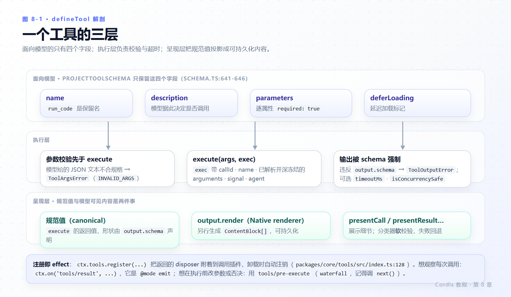
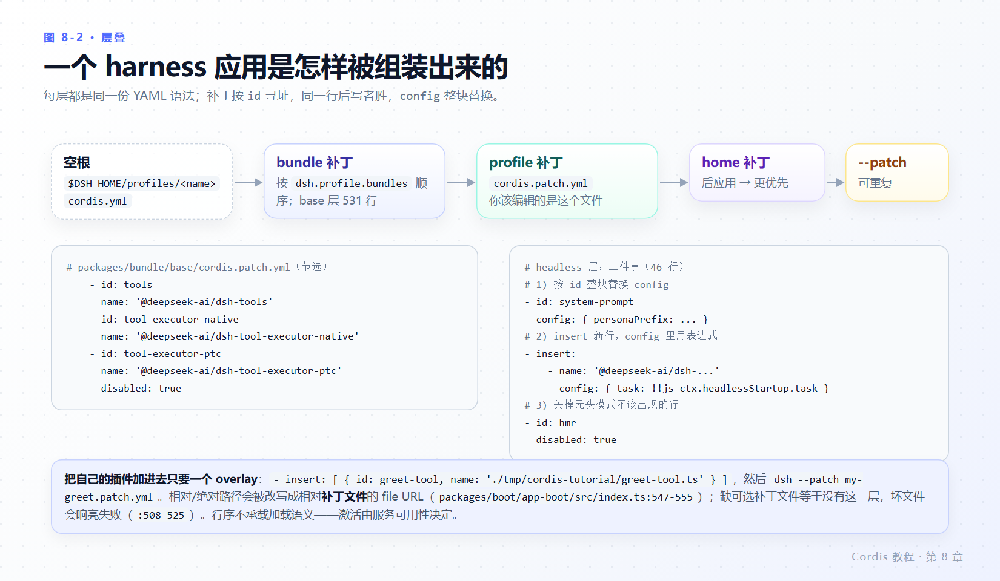

# 第 8 章 进入 harness

> **本章目标**
>
> - 向 harness 的 `tools` 服务注册一个**模型可调用**的工具，并观察它被执行。
> - 知道官方教程第 7 章的组合在当前检出上会失败，缺的是哪一个插件、为什么。
> - 拆开 `defineTool`：参数 schema 怎么变成给模型看的 JSON Schema、`output.schema` 与 `output.render` 分别负责什么。
> - 用 `tools/result` 事件写一个与提供方互不知情的观察者插件。
> - 读得懂 harness 真实的 `cordis.patch.yml`：`id`、`disabled`、`!!js` 都在里面。
>
> **前置知识**：第 4 章（服务与 `inject`）、第 5 章（事件模式）、第 7 章（组合）。
>
> **本章实验**：`greet-tool.ts`、`tool-logger.ts`。整章不需要模型密钥，也不会调用模型。

---

## 8.1 同一套模式，换个服务

前七章的服务是自己编的（`greeter`、`stats`）。harness 把同样的模式用在真实能力上：模型适配器、工具注册表、系统提示词、agent loop 本身都是插件，都是服务。所以本章没有新知识，只有新名字：

| 前七章 | harness |
|---|---|
| `inject = ['greeter']` | `inject = ['tools']` |
| `ctx.plugin(GreeterService)` | `ctx.tools.register(defineTool({...}))` |
| `ctx.on('stats/report', ...)` | `ctx.on('tools/result', ...)` |
| `cordis.yml` 的列表 | `packages/bundle/base/cordis.patch.yml` 的 531 行 |

---

## 8.2 工具插件

创建 `greet-tool.ts`：

```ts
import type { Context } from '@deepseek-ai/cordis'
import { brandString } from '@deepseek-ai/dsh-brand'
import { defineTool } from '@deepseek-ai/dsh-tools'
import type { ToolCallId } from '@deepseek-ai/dsh-llm'

export const name = 'greet-tool'
export const inject = ['tools']

export function apply(ctx: Context) {
  ctx.tools.register(defineTool({
    name: 'greet',
    description: 'Greet the named person.',
    parameters: {
      name: { type: 'string', required: true, description: 'Who to greet' },
    },
    output: {
      schema: { type: 'string' },
      render: (_args, value) => [{ type: 'text', text: value }],
    },
    async execute(args) {
      return `Hello, ${args.name}!`
    },
  }))

  // Drive one call through the real execution pipeline, standing in for
  // the model. ToolCallId brands the correlation id a provider would issue.
  void (async () => {
    const result = await ctx.tools.execute({
      calls: [{
        type: 'tool-call', id: brandString<ToolCallId>('demo-1'),
        name: 'greet', arguments: JSON.stringify({ name: 'Cordis' }),
      }],
      signal: new AbortController().signal,
    })
    console.log('tool replied:', JSON.stringify(result.results[0]?.result.content))
  })()
}
```

每个模式都来自前几章：`inject: ['tools']`（第 4 章）让插件等工具注册表就绪；`ctx.tools.register(...)` 把注册的 disposer 附着到插件（第 3 章），因此卸载时自动注销工具。

那个 `brandString<ToolCallId>('demo-1')` 不是装饰。`ToolCallId` 是 branded string（`packages/llm/llm/src/brand.ts:31`；`Branded<B> = string & { readonly [BRAND]: B }` 定义在 `packages/util/brand/src/index.ts:18`），`ToolBatchInput.calls[].id` 的类型就是它（`packages/llm/llm/src/types.ts:112-119`）。真实 id 由模型提供方签发，demo 里自己造就必须显式 branding，否则类型检查不过；`brandString` 本身是编译期转换，运行时是恒等函数（`packages/util/brand/src/index.ts:28-30`）。

`arguments` 是**字符串**：那是模型给出的原始 JSON 文本，校验发生在工具流水线里，不在你构造调用时。

---

## 8.3 官方组合会失败，缺的是 executor

先按官方教程的组合跑：

```yaml
- name: '@deepseek-ai/dsh-system-prompt'
- name: '@deepseek-ai/dsh-tools'
- name: './tool-logger.ts'
- name: './greet-tool.ts'
```

**实测**（退出码 **1**）：

```text
D:\workspace\harness\deepseek\deepseek-harness\packages\core\tools\src\index.ts:365
    if (executor === undefined) throw new ToolExecutorUnavailableError()
                                      ^

ToolExecutorUnavailableError: The selected tool executor is unavailable. Load an executor in this composition before running the agent.
    at Proxy.selectExecutor (.../packages/core/tools/src/index.ts:365:39)
    at Proxy.execute (.../packages/core/tools/src/index.ts:376:17)
    at <anonymous> (.../tmp/cordis-tutorial/greet-tool.ts:28:36)
    ...
  code: 'TOOL_EXECUTOR_UNAVAILABLE'
```

原因：`ctx.tools.execute(...)` 需要一个**执行器**插件。`@deepseek-ai/dsh-tools` 只负责注册表与 schema 投影，真正把调用派发出去的是 `@deepseek-ai/dsh-tool-executor-native`（harness 在 base 层就是这么配的：`packages/bundle/base/cordis.patch.yml:497-498`）：

```yaml
- id: tool-executor-native
  name: '@deepseek-ai/dsh-tool-executor-native'
```

这是本教程与官方教程的第 3 处分歧：**官方第 7 章的四行组合在当前检出上不能运行**，`greet-tool.ts` 里那句“standing in for the model”确实需要执行器来站这个台。注意这一条和第 2 章不同——它是**响**的：异常没有被吞掉，因为它发生在插件 `apply` 之后的 `void (async () => ...)` 里，属于未处理的 promise 拒绝，Node 默认以 1 退出。

> 一个通用判别：Cordis 生命周期**内**的异常进 logger（静默）；生命周期**外**你自己发起的异步调用异常照样炸给 Node。

补上执行器后：

```yaml
- name: '@deepseek-ai/dsh-system-prompt'
- name: '@deepseek-ai/dsh-tools'
- name: '@deepseek-ai/dsh-tool-executor-native'
- name: './tool-logger.ts'
- name: './greet-tool.ts'
```

**实测**（退出码 0）：

```text
[tool-logger] greet -> Hello, Cordis!
tool replied: [{"type":"text","text":"Hello, Cordis!"}]
```

与官方预期输出逐字一致，且顺序也对：logger 先触发。`tools/result` 在结果物化过程中发出，发生在 `execute` 返回给调用方的 promise 兑现**之前**（发射点 `packages/core/tools/src/pipeline.ts:399-419`，发出前先 `Object.freeze(exec)`）。两个插件都不知道彼此存在，把它们连起来的是注册表服务和事件。

### 还有一层 PENDING

`@deepseek-ai/dsh-tools` 自己 `static inject = ['systemPrompt']`（`packages/core/tools/src/index.ts:100`），构造时用 `ctx.systemPrompt.tools(...)` 把工具 schema 贡献进系统提示词（`:113-117`）。所以组合里必须同时列出 `@deepseek-ai/dsh-system-prompt`（base 层对应行：`packages/bundle/base/cordis.patch.yml:505-509`）。

**实测**：去掉 `- name: '@deepseek-ai/dsh-system-prompt'` 后，整个组合输出 `(no output)`，退出码 0 —— 第 4 章 4.3 与第 7 章 7.5 的静默 PENDING，只不过这次等待的是 `dsh-tools` 自己。

---

## 8.4 `defineTool` 的解剖

`defineTool` 在 `packages/core/tools/src/schema.ts:555`，返回一个普通 `ToolDefinition` 字面量（`:581-603`）。它的字段分三层（`DefineToolOptions`，`schema.ts:483-546`）：



*图 8-1 · `parameters` 编译成给模型看的 JSON Schema；`execute` 返回 `output.schema` 声明的规范值；`output.render` 另行生成可持久化的结果内容。*

**面向模型的一层**（会进入系统提示词的只有这四个字段，`schema.ts:641-646` 的 `projectToolSchema`）：

| 字段 | 语义 |
|---|---|
| `name` | 工具名；`run_code` 是保留名（`contracts.ts:12`，注册时拒绝，`index.ts:128-153`） |
| `description` | 给模型看的功能说明 |
| `parameters` | 属性映射，编译为 `{ type: 'object', properties, required? }`（`parameterSchemaSpecToJsonSchema`，`schema.ts:450-459`；`compilePropertyMap`，`:418`） |
| `deferLoading` | 延迟加载标记 |

`parameters` 的必填写法是**逐属性**的 `required: true`（`schema.ts:98-107`），不是 JSON Schema 的顶层 `required` 数组；支持节点类型 `string/number/integer/boolean/null/array/object/json/oneOf`（`:25-95`），注解 `description/title/default/examples`（`:13-22`）。写了不认识的键会在开发期抛作者错误（`assertAuthorKeys`，`schema.ts:194`，调用点如 `:402`）。

**执行的一层**：

- `execute(args, exec)`：`args` 的类型由 `parameters` 推导；运行前先校验模型给的 JSON 文本，不合规格抛出 `ToolArgsError`（`schema.ts:580` 构造校验器，`:598-602` 抛出，code `INVALID_ARGS`）。
- `timeoutMs?`（`:503`）、`isConcurrencySafe?(args)`（`:509`）：超时与并发归类；重试策略在独立包里（`@deepseek-ai/dsh-tool-call-timeout-policy`）。
- `output.schema`：声明规范返回值的形状，运行时强制执行（`contracts.ts:16-23`；不合规格为 `ToolOutputError`，`contracts.ts:309-319`）。

**呈现的一层**（都在 `DefineToolOptions`，`:523-545`）：`output.render` 是 Native renderer，把规范值投影成 `ContentBlock[]`；`output.presentationMeta`、`projectContent`、`finalizeContent`、`presentCall`、`presentResult` 处理展示细节。分类器校验是**软**的，失败会回退而不炸（`:610-631`）。

`ctx.tools` 服务本体：`ToolsService extends Service`，`super(ctx, 'tools')`（`index.ts:99, 111-113`），`declare module` 合并进 `Context`（`:32-36`）。公开方法有 `register`、`restrict`、`get`、`executable`、`resolve`、`definitions`、`schemas`、`setExecutor`、`execute`、`guard`、`checkGuards`。

`tools/result` 的签名与模式记录在 `packages/core/tools/src/events.ts:42-49`：

```ts
'tools/result'(this: Scoped<ToolsService>, exec: Readonly<ToolExecution>, result: Readonly<ToolExecutionResult>): undefined
// @mode emit
```

`exec` 携带 `callId`、`rootCallId`、`name`、`arguments`（已解析并深冻结）、`agent`、`toolSet`、`parent`、`token`、`signal`（`contracts.ts:166-224`）。同族事件 `tools/pre-execute` / `tools/execute` / `tools/post-execute` 是 `waterfall`，`tools/change` 是 `emit`（`events.ts:18-56`）——第 5 章的模式表在这里直接可用：想在执行前替换参数或否决调用，就挂 waterfall；只想观察，就挂 emit 的 `tools/result`，并且**不要**在 waterfall 监听器里忘记调用 `next()`。

创建 `tool-logger.ts`：

```ts
import type { Context } from '@deepseek-ai/cordis'
import type {} from '@deepseek-ai/dsh-tools'

export const name = 'tool-logger'
export const inject = ['tools']

export function apply(ctx: Context) {
  ctx.on('tools/result', (exec, result) => {
    const text = result.content
      .map(block => (block.type === 'text' ? block.text : ''))
      .join('')
    console.log(`[tool-logger] ${exec.name} -> ${text}`)
  })
}
```

`import type {} from '@deepseek-ai/dsh-tools'` 引入该包的声明合并，让 `'tools/result'` 及其 payload 有类型——和第 5 章导入 `./stats.ts` 是同一手法，只是提升到包级别。

---

## 8.5 真实的应用组合长什么样

你现在已经能读懂 harness 的组装文件了。`packages/bundle/base/cordis.patch.yml` 的开头注释（`:1-13`）说明了规则：后续 bundle 补丁和用户自己的 `cordis.patch.yml` **按 `id` 寻址行，同一行后写者胜**；补丁**替换目标行整个 `config`**，不是合并；行序不承载加载语义（激活由服务可用性驱动）。

代表性片段（原样摘录）：

```yaml
    - id: tools
      name: '@deepseek-ai/dsh-tools'

    - id: tool-executor-native
      name: '@deepseek-ai/dsh-tool-executor-native'

    - id: tool-executor-ptc
      name: '@deepseek-ai/dsh-tool-executor-ptc'
      disabled: true

    - id: system-prompt
      name: '@deepseek-ai/dsh-system-prompt'
      config:
        personaPrefix: ''

    - id: agent-loop
      name: '@deepseek-ai/dsh-agent-loop'
      config:
        agents: []
```

用到的元数据正是第 6、7 章那几个字段：`id`（97 处）、`name`（97 处）、`config`（33 处）、`disabled`、`!!js`（如 `:22` 的 `disabled: !!js "!ctx.get('profileContext')"`）。



*图 8-2 · 空根 + 有序 bundle 补丁 + profile 补丁 + home 补丁 + `--patch` overlay；每层按 `id` 寻址，后写者胜。*

层叠顺序（`apps/cli/src/profile-boot.ts:81-84` 的根注释与实现）：

```text
$DSH_HOME/profiles/<name>/cordis.yml          ← 空根
  → 各 bundle 的 dsh.bundle.patch（package.json 声明的顺序）
  → profile 的 cordis.patch.yml
  → home 级补丁（homePatchPath()，profile-boot.ts:73-75，后 applied 故更优先）
  → --patch <path> 叠加（可重复；args.ts:170）
```

`headless` 层是很好的第二个样本：`packages/bundle/headless/cordis.patch.yml` 只有 46 行，做三件事——按 `id` 整块替换 `config`（`:9-12` 的 persona）、`insert` 两行新配置项（`:14-25`，其中 `config: task: !!js ctx.headlessStartup.task`）、把 `hmr`/`credentials`/`authorization`/`deepseek-account` 全部 `disabled: true`（`:35-46`）。

把自己的 `greet-tool.ts` 加进去，只需要一个小的 overlay 文件：

```yaml
# my-greet.patch.yml
- insert:
    - id: greet-tool
      name: './tmp/cordis-tutorial/greet-tool.ts'
```

```sh
dsh --patch my-greet.patch.yml
```

overlay 里相对/绝对路径的插件名会被改写成相对**补丁文件**的 file URL（`packages/boot/app-boot/src/index.ts:547-555`）；缺失的可选补丁文件等于“没有这一层”，坏文件会响亮失败（`:508-525`）。

---

## 8.6 从这里走向完整 agent

真实 agent 就是这套组合再加更多插件：LLM 适配器、agent loop、持久化、应用入口。你已经能逐行读懂 [base 层](https://github.com/deepseek-ai/deepseek-harness/blob/master/packages/bundle/base/cordis.patch.yml) 与 [headless 层](https://github.com/deepseek-ai/deepseek-harness/blob/master/packages/bundle/headless/cordis.patch.yml)。

最小可运行的 harness 侧工具插件其实就在仓库的测试夹具里，20 行：`packages/core/tools/tests/fixtures/literal-sdk.ts`（`:7` 的 `inject`、`:10` 的 `ctx.tools.register(defineTool({...}))`、`:13` 的参数、`:14-17` 的 output 两层、`:18` 的 execute）。想抄一个“最短正确写法”，抄它比抄产品代码更合适。产品侧最短的是 `packages/deliverables/tool-present/src/index.ts:38-58`。

批量调用的测试写法可参考 `packages/test-support/tool-testkit/src/index.ts:76-92`——它给出的正是本章 `ctx.tools.execute({ calls: [...], signal })` 的形状，并直接读 `batch.results[0].result`。

---

## 8.7 本章小结

- harness 的 `tools` 与自编服务完全同构：`inject = ['tools']` 等就绪、`register` 的 disposer 挂在插件上、`tools/result` 是 `@mode emit`。
- 官方第 7 章的组合在当前检出会 `ToolExecutorUnavailableError` 并以 1 退出；缺的是 `@deepseek-ai/dsh-tool-executor-native`。补上后官方预期输出逐字复现，且 logger 先于 `execute` 的 promise 完成。
- 少了 `@deepseek-ai/dsh-system-prompt`，整套静默 PENDING（`dsh-tools` 自己 `inject` 了 `systemPrompt`）——第 7 章的诊断法在这里照样管用。
- `defineTool` 分三层：面向模型（`name`/`description`/`parameters`/`deferLoading`）、执行（校验 args、`output.schema` 强制、`timeoutMs`）、呈现（`render` 与一组 present\* 回调）。
- 生命周期内的 Cordis 异常静默进 logger；你自己 `void (async () => ...)` 里的异常照常炸给 Node——这一区分决定了你看不看得见问题。
- 真实组合就是同一份 YAML 语法加上补丁层叠：按 `id` 寻址、后写者胜、整块替换 `config`。

### 检查点

1. 为什么 demo 里必须写 `brandString<ToolCallId>('demo-1')` 而不是 `'demo-1'`？
2. 只挂 `dsh-tools` 不挂 executor，症状是崩溃还是静默？只挂 `dsh-tools` 不挂 `system-prompt` 呢？
3. `parameters` 里怎么表达“必填”？`{ required: ['name'] }` 这种写法会被怎样处理？
4. 你想在工具执行前把某个参数替换掉，应该挂哪个事件、要遵守哪条纪律？
5. 官方教程的四行组合在你的机器上也失败了——写出你加的那一行及其源码依据。

## 延伸阅读

- 官方：[进入 harness](https://deepseek-harness.github.io/deepseek-harness/develop/cordis-tutorial/07-into-the-harness)
- 仓库：`docs/user/develop/basic/index.zh.md`（第一个 Harness 插件）、`docs/user/develop/basic/tool.zh.md`（`defineTool` 深入）
- 三层能力设计：`docs/user/develop/practice/index.zh.md`；服务/事件清单：`docs/subsystems/core.zh.md` 的 `cordis-surface` 区块
- 系统地图：`docs/architecture.zh.md`
- 源码：`packages/core/tools/src/{schema.ts,contracts.ts,index.ts,events.ts,pipeline.ts}`、`packages/boot/app-boot/src/index.ts:508-557`、`apps/cli/src/{args.ts,profile-boot.ts}`
- 想把插件打包安装交付：见姊妹教材 [dsh-beginner-tutorial 第 8 章](../dsh-beginner-tutorial/08-package-and-install.md)。
