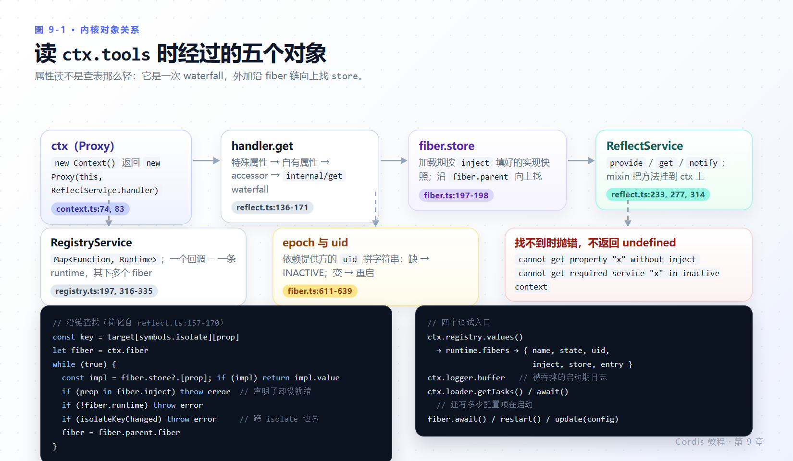

# 第 9 章 内核视角

> **本章目标**
>
> - 说得清 `ctx` 为什么是一个 Proxy，以及 `ctx.greeter` 这个属性访问在运行时走了哪条路。
> - 知道 `RegistryService` / `Fiber` / `ReflectService` / `EventsService` / `LoggerService` 各自负责什么，以及它们如何互相调用。
> - 用 epoch 解释“依赖变化为什么会重启插件”。
> - 看懂 Loader 的分层（Loader → EntryGroup → Entry → EntryTree → Include）与三个 `internal/*` 钩子。
> - 掌握几个调试入口：`ctx.registry`、`fiber.uid` / `fiber.store`、`ctx.logger.buffer`。
>
> **前置知识**：第 3、4、7 章。本章不引入新 API，只回答“为什么”。
>
> **说明**：以下实现细节以 `deepseek-harness/vendor/` 副本为准（`@deepseek-ai/cordis 4.0.6-alpha.1`、`@deepseek-ai/cordis-plugin-loader 1.0.7-alpha.1`）。上游 `cordis/packages/core` 逻辑等价但符号命名有差（第 1 章 1.4）。

---

## 9.1 `ctx` 是 Proxy，不是普通对象

`new Context()` 的构造器（`vendor/cordis/src/context.ts:70-84`）做了六件事，最后**返回的不是 `this`**：

```ts
constructor() {
  this[symbols.isolate] = Object.create(null)
  this[symbols.intercept] = Object.create(null)
  const self = new Proxy<this>(this, ReflectService.handler)
  this.root = self
  this.baseUrl = undefined
  this.fiber = new Fiber(self, {}, Object.create(null), null, () => [])
  this.reflect = new ReflectService(self)
  this.registry = new RegistryService(self)
  this.events = new EventsService(self)
  this.logger = new LoggerService(self)
  this.fiber._disposables.clear()
  return self
}
```

| 动作 | 目的 |
|---|---|
| 建 isolate / intercept 两张影子表 | 服务隔离与配置拦截的作用域起点（第 7 章 7.1） |
| 把 `this` 包成 Proxy，handler 是 `ReflectService.handler` | 让“读一个不存在的属性”变成一次服务查找 |
| `this.root = self` | 根上下文自引用；注意指向的是 **proxy** |
| 建根 fiber（`runtime` 传 `null`） | 整棵插件树的根作用域；`runtime` 为 `null` 正是“根”的标记（`fiber.ts:222-228`） |
| 依次装 Reflect / Registry / Events / Logger | 四个内置服务，其余能力都靠 mixin 挂到上下文上 |
| `return self` | 你拿到的 `ctx` 永远是那个 Proxy |

`Context.is(value)` 靠 `Symbol.for('cordis.is')` 做品牌检查（`context.ts:61-68`），所以跨 realm、跨副本的上下文仍然能被识别——这在 vendor 与上游包名并存的工程里不是可有可无的。

插件方法（`get`/`set`/`provide`/`effect`/`inject`/`plugin`/`on`/`once`/`emit`/`parallel`/`serial`/`bail`/`waterfall` 等）不是写在 `Context.prototype` 上的，而是 `ReflectService` 构造时通过 mixin 声明挂进去的（`vendor/cordis/src/reflect.ts:219-222`）。这解释了一件怪事：在 `vendor/cordis/src/index.ts` 里没有 `Hooks` 命名空间，也没有 `ctx.scope`、`ctx.platform`——**这些名字在本版本的核心里不存在**，教程和文档若提到它们属于别的层次或旧版本。

---

## 9.2 一次 `ctx.greeter` 属性访问的完整路径



*图 9-1 · Proxy `get` → 保留属性 → 自有属性 → `internal/get` waterfall → 沿 fiber 链在 `store` 里找实现。找不到就抛错，而不是返回 `undefined`。*

`ReflectService.handler.get`（`vendor/cordis/src/reflect.ts:136-171`）的判定顺序：

1. **保留属性**（`isSpecialProperty`，`reflect.ts:80-91`：symbol、`prototype`/`then`、纯数字字符串、以 `_` 开头）→ 直接 `Reflect.get(target, prop, ctx)`。
2. **target 上已有的属性**（含 `fiber`、`root`、四个内置服务）→ `getTraceable(...)` 后返回。
3. 否则准备一个错误对象：`cannot get property "<prop>" without inject`，然后：
   - 若该名字注册为 accessor，走 accessor 的 `get`；
   - 若当前 fiber 没有 `runtime`（尚未加载完）→ `ctx.reflect.get(prop, false)`；
   - 否则分发 **`internal/get` waterfall**，最内层做真正的工作：
     ```ts
     const key = target[symbols.isolate][prop]
     let fiber = (ctx[symbols.shadow] as Context ?? ctx).fiber
     while (true) {
       const impl = fiber.store?.[prop]
       if (impl) return getTraceable(ctx, impl.value)
       if (prop in fiber.inject) { error.message = `cannot get required service "${prop}" in inactive context`; throw error }
       if (!fiber.runtime) throw error
       if (fiber.parent[symbols.isolate][prop] !== key) throw error
       fiber = fiber.parent.fiber
     }
     ```

三件事由此说清：

- **为什么必须有 `inject`**：实现存在 `fiber.store` 里，是加载时按 `inject` 快照填充的（“所需服务实现的加载期快照”，`vendor/cordis/src/fiber.ts:197-198`）。没声明依赖，就没有可查的 store，直接抛错。
- **为什么不 `inject` 时 `ctx.x` 会炸而不返回 `undefined`**：上面第 1、3 条分支都会 `throw`。**可选依赖要用 `ctx.get('x')`**（`vendor/cordis/src/reflect.ts:233`），它是显式的“可能没有”入口。
- **隔离是怎么生效的**：沿 fiber 链向上走时，一旦父作用域对该名字的 isolate key 不同就抛错——这正是 `isolate: { shell: true }` 让两个组各看到一份 `shell` 的实现点。

写入方向对称：`handler.set`（`reflect.ts:173-197`）在名字没有注册时抛 `cannot set property "<prop>" without provide`，否则走 `internal/set` waterfall 再到 `ctx.reflect.set`。

**实测**（`exp-errors.ts`）：

```text
A 无 inject 读服务: name=Error code=- message="cannot get property \"greeter\" without inject"
B 无 provide 赋值: name=Error code=- message="cannot set property \"whatever\" without provide"
```

---

## 9.3 Registry：一个插件，多个 fiber

`ctx.plugin()` 的真实实现（`vendor/cordis/src/registry.ts:316-335`）：

```ts
plugin(plugin: Plugin, config?: any, getOuterStack = buildOuterStack()) {
  const callback = this.resolve(plugin)
  if (!callback) throw new Error('invalid plugin, expect function or object with an "apply" method, received ' + typeof plugin)
  this.ctx.fiber.assertActive()

  let runtime = this._internal.get(callback)
  if (!runtime) {
    let name = plugin.name
    if (name === 'apply') name = undefined
    runtime = { name, callback, fibers: new DisposableList(), Config: plugin.Config }
    this._internal.set(callback, runtime)
  }

  const fiber = new Fiber(this.ctx, config, Inject.resolve(plugin.inject), runtime, getOuterStack)
  const wrapped = Object.create(fiber) as Fiber & PromiseLike<Fiber>
  wrapped.then = (onFulfilled, onRejected) => fiber.await().then(onFulfilled, onRejected)
  return wrapped
}
```

读出来的四条：

1. **`runtime` 以解析出的回调为键**，即“同一个插件函数/类”对应一条 runtime 记录，其下挂着它的**所有 fiber**（`runtime.fibers`）。第 3 章注册表快照里 `for (const runtime of ctx.registry.values()) for (const fiber of runtime.fibers)` 的两层循环就是这个结构。
2. **`if (name === 'apply') name = undefined`**：用对象字面量内联写法 `ctx.plugin({ apply(ctx) {...} })` 时，函数名会误报成 `apply`，核心专门把它抹掉。所以诊断信息里看不到“apply”这种无意义名字——这是刻意修的。
3. **返回的是 `Object.create(fiber)` 再加 `.then`**：这就是第 3 章说的“既是 Fiber 又是 PromiseLike”。`await ctx.plugin(...)` 等的是加载完成，`ctx.plugin(...).dispose()` 立刻可用。
4. **`assertActive()`**：在已 dispose 的上下文里挂插件会直接抛错（配合第 9.5 节的 `INACTIVE_EFFECT`）。

`ctx.inject(deps, callback)` 只是糖：`this.plugin({ inject, apply: callback, name: callback.name })`（`registry.ts:300-302`）。

`Inject.resolve(plugin.inject)` 把数组 `['tools']` 或名字→配置的映射统一成内部形态（`registry.ts:71-88`）。第 3 章快照里看到的 `inject={"timer":null}` 就是它的产物，键是依赖名，值在就绪前为 `null`。

---

## 9.4 epoch：依赖反应性的实现

第 4 章实测了“提供方消失 → 消费方卸载 → 恢复 → 重新加载”。机制是一段字符串比较：

- 每次要改变 fiber 生命周期时走 `_setEpoch` → `_reload()`（LOADING）或 `_unload()`（UNLOADING）（`vendor/cordis/src/fiber.ts:625-639`）。
- epoch 由该 fiber 每个依赖提供方的 `fiber.uid` 拼成；**任何依赖缺失 → `INACTIVE` → 卸载**；提供方 uid 变了（重启/替换）→ 新 epoch → 重新加载。
- 状态的读出来是自 `uid` / `_error` / epoch 的派生（`fiber.ts:574-579`），`_updateState` 会发出 `internal/status` 事件（`fiber.ts:581-595`）。
- 触发点在服务注销处：`provide` 的 disposer 调用 `reflect.notify([name])` 并等待受影响 fiber 收敛（`vendor/cordis/src/reflect.ts:297-303`）；`notify` 扫描注册表里 `inject` 含该名字的所有 fiber，逐个 `_checkImpl(name)` + `_refresh()`（`reflect.ts:314-336`）。

`uid` 是单调编号（根 fiber 为 0，dispose 后置 `null`），所以 epoch 天然随“哪一份实现”变化。这也解释了第 4 章那句提醒：`ctx.get()` 拿到的是**当前 uid 对应的实现**，不写 `inject` 就永远不会有重启为你兜底。

---

## 9.5 effect、disposer 与失败清理

第 3 章的三条规则在源码里对应三处：

| 规则 | 位置 |
|---|---|
| 单 effect 内 disposer 逆序、逐个 await | `vendor/cordis/src/fiber.ts:427-442` |
| fiber 卸载时各 effect 并发（`Promise.all`），错误只记 logger | `vendor/cordis/src/fiber.ts:702-713` |
| `DisposableList.clear()` 返回逆序数组 | `vendor/cordis/src/utils.ts:27-31` |
| 加载期异常交给 logger，fiber 记 `_error` → FAILED | `vendor/cordis/src/fiber.ts:686-691` |
| `dispose()` 自身注册为父 fiber 的 effect，并 `while (this.inertia) await` | `vendor/cordis/src/fiber.ts:265-297` |

另外两条错误路径也一并实测了（`exp-errors.ts`）：

```text
C emit 监听器抛错: name=Error code=- message="listener blew up (emit)"
D parallel 监听器抛错: name=AggregateError code=- message=""
E dispose 后再 effect: name=Error code=INACTIVE_EFFECT message="cannot create effect on inactive context"
```

**`emit` 是同步广播，但异常是同步传播的。** 第 5 章那张表里“不会等待或收集返回的 promise 与值”说的是返回值，不包含抛出的错误——实测 `ctx.emit` 直接把它扔回调用方（`C: emit 返回了` 这行因此没有打印）。`parallel` 则把所有拒绝聚合成 `AggregateError`（`vendor/cordis/src/events.ts:183-187`）。harness 的产品代码之所以敢在 `tools/result` 上挂观察者，是因为发射点自己做了一层保护：观察者异常被捕获并交给 logger，永不外泄（`packages/core/tools/src/pipeline.ts:399-419`）。这是提供方的责任，不是 `emit` 的默认行为。

---

## 9.6 Loader 的分层与三个钩子

配置层的对象关系（`vendor/loader/src/`）：

```text
Loader (服务名 'loader')
  └─ EntryGroup            一组配置项；update() 按 id 差分后 Promise.all
       ├─ Entry            单个配置项：解析 name → import → registry.plugin()
       │    └─ EntryTree   解析与读写（相对路径 / NPM 包名 / cordis: / internal）
       └─ EntryGroup …      group: true 时嵌套子组
Include (插件包)            读 YAML（含 !!js）、比较新旧、按 filename 响应 HMR
Group (插件包)              把嵌套子列表当作一个单元挂载/卸载
isolate / intercept        给某个名字换 realm（Context.isolate / Context.intercept）
```

要点：

- **解析顺序**（`vendor/loader/src/config/tree.ts:112-132`）：`cordis:` 前缀查 `ctx.loader.builtins` → 有 `internal` 时走 Node 内部 loader import → `.` 开头按 `new URL(name, ctx.baseUrl)` → 否则按 NPM 包名用项目解析器（解析器会就近写一个 `<scope>/.cordis/resolve.mjs`，`vendor/loader/src/resolve.ts:11-30`）。
- **三个 `internal/*` 钩子**：`internal/plugin`（给 fiber 关联 `fiber.entry`、解析条目级 `inject`、把“插件自杀”翻译成 `disabled: true` 并写回文件，`vendor/loader/src/index.ts:129-166`）、`internal/config`（按 fiber 插值 `!!js`，带 `EntryGroup.key` 标记的载体跳过，`index.ts:104-113`）、`internal/update`（全局 + prepend，写回并记 `reload` 日志，`index.ts:115-127`；Include 在这一钩子上**否决** fiber 重启、改为就地更新子条目，`vendor/include/src/index.ts:190-200`）。
- **就绪语义**：`Loader[Service.check]` 配合 `intercept.await`，让依赖 `loader` 的插件在有任务未排空时保持等待（`vendor/loader/src/index.ts:66-69, 175-179`；`getTasks()` / `await()` 在 `config/tree.ts:36-50`）。这就是“配置项还没加载完，别人先别跑”的实现。
- **fiber 自杀会被记回配置**：`internal/plugin` 里那条分支——插件 dispose 自己时，Loader 把该条目写成 `disabled: true` 并回写文件。第 7 章 7.4 的 `disabled` 语义在这里有个你未必想要的副作用：**运行期自毁会改动你的 YAML**。

---

## 9.7 四个调试入口

| 入口 | 拿到什么 | 出处 |
|---|---|---|
| `ctx.registry.values()` → `runtime{name, callback, fibers, Config}` → `fiber{name,state,uid,inject,store,config}` | 谁挂载了、停在哪个状态、在等哪个服务 | runtime 字段 `registry.ts:136-145`、映射表 `:197`；fiber 字段 `fiber.ts:184-233` |
| `ctx.logger.buffer`（`Message[] = {sn, ts, name, type, level, args, fiber?}`，上限 1000） | 被吞掉的启动期错误 | 消息结构 `vendor/cordis/src/logger.ts:30-38`；buffer 与内置导出器 `:195-196, 213-221` |
| `ctx.loader.getTasks()` / `await ctx.loader.await()` | 还有没有配置项在启动中 | `vendor/loader/src/config/tree.ts:36-50` |
| `fiber.await()` / `fiber.restart()` / `fiber.update()` | 等加载完成、手动重启、走一遍更新生命周期 | `vendor/cordis/src/fiber.ts:731, 745, 764` |

第 2 章的 `log-replay.ts` 和第 3 章的 `exp-states.ts` 就是前两个入口的最小可用封装；把两个文件常驻在你的调试目录里，能省掉大部分“为什么没反应”的猜测。

另外两个只在有 Loader 时才存在的字段：`fiber.entry`（配置项对象，含 `options.id` 与 `disabled`）不是核心 `Fiber` 的成员，而是 `internal/plugin` 在挂载时挂上去的（`vendor/loader/src/index.ts:130-134`）；纯用 `ctx.plugin()` 手搓的应用里没有它。

---

## 9.8 本章小结

- `ctx` 是 Proxy：`ReflectService.handler` 把未知属性读转换成服务查找，找不到就抛错（不是 `undefined`）；插件方法来自 mixin，核心里没有 `ctx.scope`、`ctx.platform`、`Hooks`、`Setup`。
- `registry.plugin()` 以回调为键维护 runtime，一个插件可以有多个 fiber；返回 thenable 的 fiber 包装；内联 `{ apply }` 的假名字 `apply` 被显式抹掉。
- 依赖反应性 = 用依赖提供方的 `uid` 拼 epoch，缺失即 INACTIVE，变化即重启；`provide` 的 disposer 通过 `reflect.notify` 触发它。
- `emit` 同步传播监听器异常，`parallel` 聚合为 `AggregateError`，dispose 后再 `ctx.effect()` 抛 `INACTIVE_EFFECT`；harness 在 `tools/result` 发射点自行包了一层保护。
- Loader 层按 `id` 差分并发启动；三个 `internal/*` 钩子把配置、插件生命周期与文件写回连在一起——注意“插件自毁会回写 `disabled: true`”。
- 排障四件套：注册表快照、logger buffer、loader 任务队列、fiber 的 await/restart/update。

### 检查点

1. `ctx.tools` 和 `ctx.get('tools')` 在“没声明 inject”时的行为差别是什么？
2. 一个插件函数被挂两次，注册表里是一条 runtime 还是两条？fiber 呢？
3. 提供方重启后，为什么消费方一定被重启，而不是看到“半新半旧”的引用？
4. 你在卸载完成的上下文里调用 `ctx.effect()`，得到什么错误？
5. 你的插件自己 `fiber.dispose()`，配置文件会发生什么？

## 延伸阅读

- 仓库：`docs/cordis-api/context.zh.md`、`fiber.zh.md`、`registry.zh.md`、`service.zh.md`、`inherited.md`（mixin 出来的方法清单）
- `vendor/README.md`：vendor 源码与上游同步流程
- 源码：`vendor/cordis/src/{context.ts,reflect.ts,registry.ts,fiber.ts,events.ts,service.ts,logger.ts,utils.ts}`、`vendor/loader/src/{index.ts,resolve.ts,internal.ts,config/entry.ts,config/group.ts,config/tree.ts,config/isolate.ts}`、`vendor/include/src/index.ts`
- 风格审查：仓库技能 `cordis-styling-nitpicking`（针对单例状态、未回卷副作用、清理顺序做代码审查）
- 更细的源码剖析：[dsh-advanced-tutorial 第 2 章 Cordis 内核](../dsh-advanced-tutorial/02-cordis-kernel.md)
