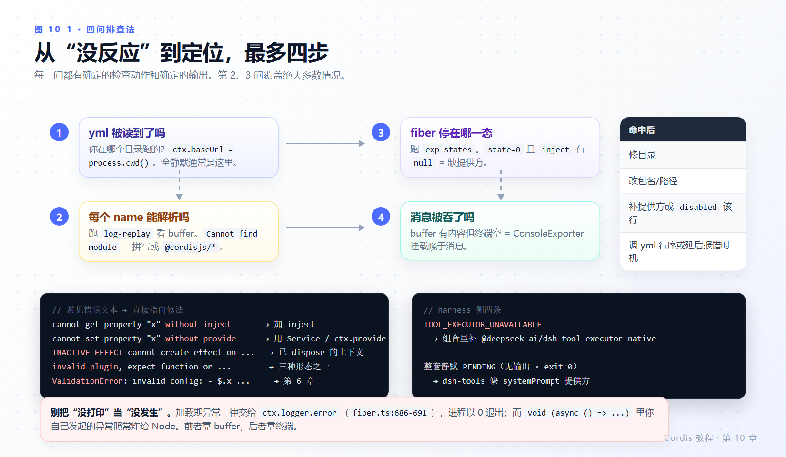

# 第 10 章 陷阱与调试

> **本章目标**
>
> - 用一条固定流程回答“我的插件为什么没反应”，不再靠猜。
> - 记住 Cordis 在本版本里真实抛出的错误文本，看到就能定位。
> - 认识本章列的 14 个陷阱，其中每一个都有本教程的实测或源码支撑。
> - 装好三个最小诊断插件，长期放在你的调试目录里。
> - 手里有一份“本教程与官方文档的已知分歧”清单。
>
> **前置知识**：第 2、3、4、7 章。
>
> **本章实验**：`diagnose.ts`、`log-replay.ts`、`exp-states.ts`、`exp-errors.ts`（前面章节已建）。

---

## 10.1 四问排查法



*图 10-1 · 依次问：yml 被读到了吗 → 名字解析成功吗 → fiber 停在哪一态 → 有没有消息被吞。三行输出就能定案。*

| # | 问题 | 怎么问 | 典型答案 |
|---|---|---|---|
| 1 | `cordis.yml` 被读到了吗 | 确认你在 yml 同级目录运行；故意写一行坏 YAML 看行为是否改变 | 没读到 = 目录错了（`ctx.baseUrl` 来自 `process.cwd()`，`vendor/cordis/bin.js:8`） |
| 2 | 每个 `name` 都能解析吗 | 挂 `log-replay` 看 buffer | 有 `Cannot find module ...` = 拼写或用了 `@cordisjs/*` 前缀 |
| 3 | fiber 停在哪一态 | 挂 `exp-states` 看注册表快照 | `state=0` 且 `inject` 里有 `null` = 缺服务提供方 |
| 4 | 有没有消息被吞 | `ctx.logger.buffer` 的长度与内容 | 长度 > 0 但终端空 = 导出器没就位（第 2 章实验 B） |

四问的顺序就是成功率顺序。实践中第 2、3 问占九成。

---

## 10.2 错误信息对照表

前 5 行是**实测文本**（`exp-errors.ts` 的输出，逐字）：

| 文本 | 触发 | 位置 | 处理 |
|---|---|---|---|
| `cannot get property "<name>" without inject` | 读 `ctx.<name>` 但该插件没 `inject` 也没 runtime | `vendor/cordis/src/reflect.ts:144, 163` | 加 `inject`，或改用 `ctx.get('<name>')` |
| `cannot get required service "<name>" in inactive context` | 在已卸载/未激活的上下文里读已声明依赖 | `reflect.ts:160-161` | 检查持有 ctx 的生命周期；回调里用 `ctx.effect` 约束 |
| `cannot set property "<name>" without provide` | 给没注册过的名字赋值 | `reflect.ts:178` | 用 `Service`/`ctx.provide`，别直接赋值 |
| `cannot create effect on inactive context`（`code: INACTIVE_EFFECT`） | fiber 已 dispose 后再 `ctx.effect()` | `vendor/cordis/src/fiber.ts:353`、`docs/cordis-api/fiber.zh.md` | 把异步续作放进 effect 内部并检查活性 |
| `invalid plugin, expect function or object with an "apply" method, received <typeof>` | 传给 `ctx.plugin()` 的东西不是插件形态 | `vendor/cordis/src/registry.ts:319` | 函数 / `{apply}` / `Service` 子类，三选一（第 2 章 2.4） |

后面几行来自 harness 侧或加载路径，同样给出确切文本：

| 文本 | 触发 | 位置 |
|---|---|---|
| `ValidationError: invalid config:\n  - $.<path> expected <type> but got <value> (at <path>)` | 配置块不符合 schema | fiber 加载路径，最终进 logger（`fiber.ts:686-691`） |
| `volatile fields require a fixed object path without an enclosing volatile field (at <path>)` | volatile 声明在数组/分支内部 | schema 校验，实测见第 6 章 6.4 |
| `ToolExecutorUnavailableError: The selected tool executor is unavailable. Load an executor in this composition before running the agent.`（`code: TOOL_EXECUTOR_UNAVAILABLE`） | 组合里没有执行器就调 `ctx.tools.execute` | `packages/core/tools/src/index.ts:365` |
| `--expose-internals is required for HMR service` | HMR 拿不到 `ctx.loader.internal` | `packages/boot/hmr/src/index.ts:310-313` |
| `Cannot find module '<path>' imported from <dir>` | 配置项的 `name` 解析不到 | logger 里的 `include`/`loader` 命名消息 |
| `AggregateError`（`message` 为空） | `parallel` 中任一监听器拒绝（实测 1 个就够） | `vendor/cordis/src/events.ts:183-187` |

---

## 10.3 十四个陷阱

### 1. 启动期的错误不可见

**症状**：终端空、退出码 0，但插件确实失败了。
**根因**：加载期异常 → `ctx.logger.error(reason)`（`vendor/cordis/src/fiber.ts:686-691`）；根 logger 只有内存 buffer 导出器（`logger.ts:195-196, 213-221`）；`ConsoleExporter` 要在自己的构造函数里才注册导出器（`vendor/logger-console/src/shared.ts:54-58`），而配置项并发启动。
**修法**：常驻一个 `log-replay` 插件读 `ctx.logger.buffer`（第 2 章 2.5 实验 C）。

### 2. 包名前缀写错 = 静默跳过

`@cordisjs/plugin-loader` 在 `deepseek-harness` 检出里不可 import；正确名是 `@deepseek-ai/cordis-plugin-loader`。错的后果不是报错而是这一项被跳过（`vendor/loader/src/config/entry.ts:223-230` 只记日志）。

### 3. PENDING 的静默等待

缺提供方的插件不报错、不重试提示、不保活事件循环（第 3 章 3.3、第 4 章 4.3 实测）。合法状态，所以框架不替你判断。用 `exp-states` 或 `diagnose`。

### 4. `ctx.get()` 读的是竞态快照

同一份 YAML 里挂了 `greeter.ts` 与 `optional.ts`，**实测三次全部** `no greeter available`（第 4 章 4.5）。不写 `inject` 就没有重启兜底，你看到的是“此刻”的注册表。

### 5. 不写 `id`，编辑配置就会重挂

**实测 A/B 对照**（第 7 章 7.4）：只加一行注释，无 `id` 的行重挂了一次（`apply` 又跑），有 `id` 的没有。根因：Include 每次重新解析（`vendor/include/src/index.ts` 的 `read()`）+ 缺失 id 随机生成（`vendor/loader/src/config/tree.ts:52-59`）。

### 6. waterfall 监听器忘调 `next()`

只观察的监听器不调 `next()` 会**否决**整条下游链，包括最内层默认逻辑（第 5 章 5.4 实测）。这是最难在测试里发现的一类 bug，因为“它没报错”。

### 7. 用假值表达“我没有意见”

`isBailed` 是 `value !== null && value !== false && value !== undefined`（`vendor/cordis/src/events.ts:13-15`）。**实测 `bail` 返回了 `0`**（第 5 章 5.3）。`serial`/`bail` 的“弃权”必须写 `undefined`/`null`/`false`，`0`、`''`、`NaN` 都是命中值。

### 8. 以为 disposer 会按顺序跑完

启动是逆序的，但**跨 effect 并发**（`fiber.ts:702-713`）。实测里同步的 A、C 立即结束，异步的 B 60 ms 后才是最后一个（第 3 章 3.4）。有先后要求的清理写在同一个 disposer 里。

### 9. 把状态放在模块顶层

提供方重启 → 消费方重启（第 4 章 4.4）。模块顶层的 `let cache` 会被新 fiber 复用同一个值，也可能被别的组共享。跨重启要存续的状态交给服务实例或专门的持久化插件。

### 10. 服务名撞进扁平命名空间

`tools`、`llm`、`timer`、`loader`、`systemPrompt` 等已被 harness 占用；同名替换会重启所有注入方（第 4 章 4.6）。给自己的服务加前缀。清单在 `docs/subsystems/core.zh.md` 的 `cordis-surface` 区块。

### 11. 在 `emit` 的监听器里抛异常，炸的是发出方

**实测**（`exp-errors.ts`）：`ctx.emit('demo/boom', 1)` 直接把监听器的异常抛回调用方，`emit 返回了` 那一行没有打印。harness 的 `tools/result` 之所以安全，是发射点自己包了 try/catch 并转 logger（`packages/core/tools/src/pipeline.ts:399-419`）。你自建事件的 `emit` 没有这层保护——观察型监听器请自带 `try/catch`。

### 12. 插件自毁会回写你的 YAML

`internal/plugin` 钩子在发现 fiber 被自己 dispose 时，把对应条目标成 `disabled: true` **并写回配置文件**（`vendor/loader/src/index.ts:129-166`）。想做“运行时临时停用且不留痕”，先确认你能接受文件被改；否则改用 isolate/group 边界或换成服务级开关。

### 13. 把 volatile 当成“改了立刻生效”

第 6 章 6.4 实测：volatile-only 改变**不重挂**（复现），但运行中引用的 `.get()` 没变、`loader/volatile-update` 也没送达（未复现）。在你要用的触发路径上自己复验，别把这条当既有保证。

### 14. harness 组合缺 `systemPrompt` 或 executor

`@deepseek-ai/dsh-tools` 自己 `inject` 了 `systemPrompt`（`packages/core/tools/src/index.ts:100`）→ 缺提供方时整套静默 PENDING；执行器缺失时 `execute` 抛 `TOOL_EXECUTOR_UNAVAILABLE` 并以 1 退出（第 8 章 8.3 实测）。两个都要显式列进组合。

---

## 10.4 三个常驻诊断插件

**① `log-replay.ts`** —— 把被吞掉的启动期日志捞出来（完整代码见第 2 章 2.5 实验 C）。

**② `exp-states.ts`** —— 打印枚举数值与全量 fiber 快照：

```ts
import { FiberState, type Context } from '@deepseek-ai/cordis'

export const name = 'exp-states'

export function apply(ctx: Context) {
  setTimeout(() => {
    console.log('FiberState =', JSON.stringify({
      PENDING: FiberState.PENDING, LOADING: FiberState.LOADING, ACTIVE: FiberState.ACTIVE,
      FAILED: FiberState.FAILED, DISPOSED: FiberState.DISPOSED, UNLOADING: FiberState.UNLOADING,
    }))
    for (const runtime of ctx.registry.values()) {
      for (const fiber of runtime.fibers) {
        console.log(`  ${fiber.name}: state=${fiber.state} uid=${fiber.uid} inject=${JSON.stringify(fiber.inject)}`)
      }
    }
    process.exit(0)
  }, 400)
}
```

**实测输出样例**：

```text
FiberState = {"PENDING":0,"LOADING":1,"ACTIVE":2,"FAILED":3,"DISPOSED":4,"UNLOADING":5}
  Loader: state=2 uid=1 inject={}
  isolate: state=2 uid=2 inject={}
  Include: state=2 uid=3 inject={"loader":null}
  TimerService: state=2 uid=4 inject={}
  exp-states: state=2 uid=5 inject={}
  ConsoleExporter: state=2 uid=6 inject={}
```

去掉 `state === PENDING` 之类的过滤，还能顺手看到 `uid`（判断提供方是否被替换过）和 `fiber.entry`（配置项对象，含 `options.id`）。

**③ 一次性判别脚本** —— 怀疑某个行为时，别在文档里找答案，跑 20 行代码。第 5 章的 `exp-dispatch.ts` 与第 10 章的 `exp-errors.ts` 都是这个套路：把可疑语义写成一句能被打印出来的问题。

---

## 10.5 本教程与官方文档的已知分歧

写作时（2026-10-30，`vendor/cordis 4.0.6-alpha.1`）复现结果与 `docs/cordis-tutorial/*.zh.md` 有四处不一致，都已在前文给出复现命令与源码位置：

| # | 官方说法 | 实测/源码 | 详见 |
|---|---|---|---|
| 1 | `apply` 抛错“进程会因该错误而终止” | 不终止：终端空、退出码 0，错误进 logger buffer | [2.5 实验 A](02-first-plugin.md#实验-a让-apply-抛异常) |
| 2 | 配置校验失败“打印错误后以状态码 1 退出” | 同上；错误文本存在但只在 buffer 里 | [6.2](06-config.md#62-明确报错以及报错在哪儿) |
| 3 | 第 7 章的四行工具组合可直接运行 | 缺 `@deepseek-ai/dsh-tool-executor-native`，会抛 `TOOL_EXECUTOR_UNAVAILABLE` 且退出码 1 | [8.3](08-into-the-harness.md#83-官方组合会失败缺的是-executor) |
| 4 | `!!js` 是“本仓库的扩展” | 上游 `cordis/packages/include/src/index.ts:20-29, 33` 已有同一标签；本仓库特有的是 `entryListSchema`、`applyEntryPatches` 等周边 | [6.3](06-config.md#63-计算得到的配置值js) |

另外两处“官方没错，但容易被误读”，也一并列出：

- `ctx.effect()` 的必要性：官方说“很少需要亲自写”，但 `void (async () => ...)` 这类你自己发起的异步工作**不是** effect，异常也不会被 Cordis 接管（实测：第 8 章的 executor 异常照样炸给 Node）。
- HMR 的“请在 tsx 下运行”：不需要额外 `--expose-internals`（实测热重载正常，`vendor/loader/src/internal.ts:108-118, 131-143` 有回退路径）。

分歧的处置原则在第 1 章 1.5：**以实测和源码为准，并把差异留给读者复验**。文档站可能已经或即将修正，代码才是你运行时的真相。

---

## 10.6 本章小结

- 排查顺序固定四问：读没读到 yml → 解析成没成功 → fiber 停在哪一态 → 消息有没有被吞。第 2、3 问覆盖绝大多数情况。
- Cordis 的错误文本是有用的定位信号：`without inject` / `without provide` / `INACTIVE_EFFECT` / `invalid plugin` 四句能直接指向修法。
- 14 个陷阱里，8 个属于同一个根因：**并发启动 + 静默失败**。把 `log-replay` 和 `exp-states` 常驻，它们就不再是陷阱。
- `emit` 不外泄返回值，但外泄异常；`serial`/`bail` 的弃权只能写 `undefined`/`null`/`false`；waterfall 观察者必须调 `next()`。
- 与官方文档的分歧要留在明面上，并且每条都能被一行命令复现。

### 检查点

1. 你的插件加了新配置项，运行后什么也没发生。写出你要执行的头两条命令。
2. `cannot get property "foo" without inject` 和 `no provider` 的 PENDING，症状有何不同？
3. 为什么 `bail` 事件里返回 `''` 会被当成命中？怎么改？
4. 你希望热重载时配置生效，但没看到 `.get()` 变化。给出两种可能解释和区分它们的实验。
5. 官方教程说配置错误会让进程以 1 退出，你的终端空且退出码 0。写出证据链的三要素（代码位置、buffer 内容、复现命令）。

## 延伸阅读

- 官方：[诊断与 HMR](https://deepseek-harness.github.io/deepseek-harness/develop/cordis-tutorial/06-composition-and-hmr)
- 仓库：`docs/defensive-patterns/`（防御式写法）、`docs/cordis-api/fiber.zh.md`（错误码）、`docs/subsystems/core.zh.md`（服务/事件清单）
- 代码审查规则：仓库技能 `cordis-styling-nitpicking`（单例状态、未回卷副作用、清理顺序三类问题）
- 姊妹教材：[dsh-beginner-tutorial 第 10 章](../dsh-beginner-tutorial/10-debugging.md)（harness 侧的排障决策树与配置层）
