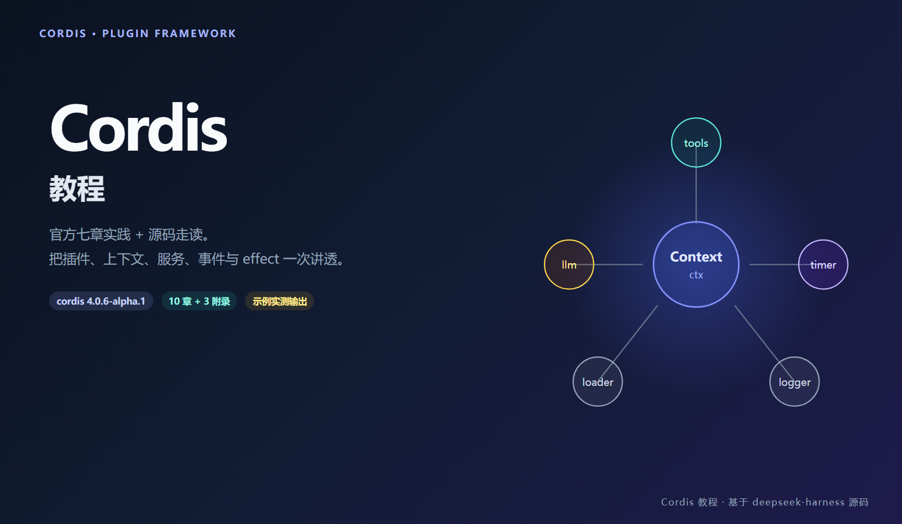
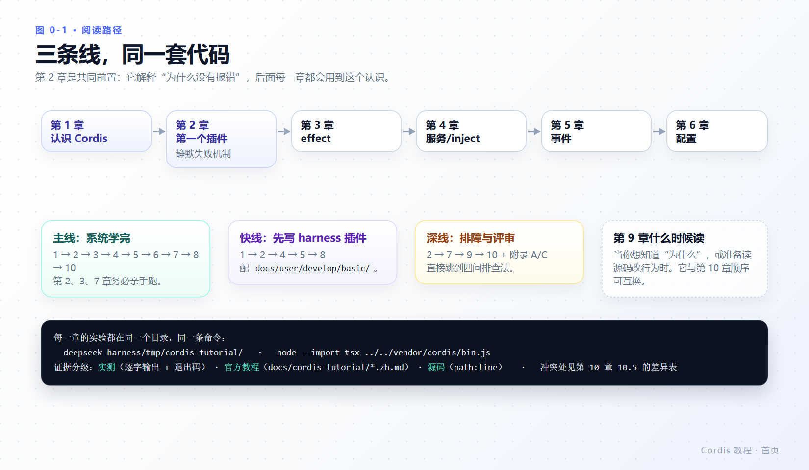

# Cordis 教程

Cordis 是 DeepSeek Harness 底层的插件框架。本教程把官方七章实践教程与仓库源码合在一起讲：每一步都能跑，每一句都有出处。



本教程基于 `@deepseek-ai/cordis 4.0.6-alpha.1` 与 `@deepseek-ai/cordis-plugin-loader 1.0.7-alpha.1`（2026-10-30 实测），内容同时对照[官方 Cordis 教程](https://deepseek-harness.github.io/deepseek-harness/develop/cordis-tutorial/01-first-plugin)与本地源码。Cordis 仍在快速演进，读到与你检出不一致的地方，以你的版本为准——书中每处“实测”都给了能重跑的文件与命令。

---

## 这本教程适合谁

- 已经（或准备）读官方 Cordis 教程七章，想要一份**把结论落到源码**的版本。
- 要给 DeepSeek Harness 写插件，需要先弄清 `ctx`、`inject`、`effect`、事件模式这些底层语义。
- 遇到过“加了插件但什么也没发生、也不报错”，想知道到底卡在哪一环。
- 会基础 TypeScript；不要求精通。书中每一处陌生语法都会被解释。

不需要 API 密钥：第 1～8 章的全部实验都在无密钥环境跑通，第 8 章也不调用模型。

如果你要的是**用起来** dsh（Web UI、模型配置、打包交付），先看姊妹教材 [`dsh-beginner-tutorial`](../dsh-beginner-tutorial/README.md)；这本专注底层框架本身。想读内核与子系统的深入剖析，另有 [`dsh-advanced-tutorial`](../dsh-advanced-tutorial/README.md)。

---

## 学完能做什么

1. 写出导出 `apply` 的函数插件，并说清对象形态与 `Service` 子类形态的解析差异。
2. 用 `ctx.effect()` 管理 Cordis 不认识的资源，并正确预期 disposer 的启动顺序与并发完成顺序。
3. 用 `inject` 声明依赖，解释提供方消失/恢复时消费方为什么会被重启。
4. 为插件写经过校验的配置，并在配置错误时**知道去哪里找那条错误**（它不在终端里）。
5. 区分五种事件分发模式的返回值与短路语义，写出不会否决下游的 waterfall 监听器。
6. 用 `id`、`group`、`disabled`、`isolate` 组织配置项，并让 HMR 真正工作起来。
7. 向 harness 的 `tools` 服务注册一个模型可调用工具，观察 `tools/result`，读懂 base/headless 组合文件。
8. 打开 `vendor/cordis/src` 读内核，用注册表快照 + logger buffer 四问定位任何“没反应”。

---

## 与官方教程的对应关系

| 官方章 | 官方页 | 本教程 |
|---|---|---|
| — | 索引（准备工作） | [第 1 章](01-what-is-cordis.md) + [第 2 章 2.1](02-first-plugin.md#21-准备工作) |
| 1. 编写第一个插件 | [01-first-plugin](https://deepseek-harness.github.io/deepseek-harness/develop/cordis-tutorial/01-first-plugin) | [第 2 章](02-first-plugin.md) |
| 2. 生命周期与 effect | [02-lifecycle-and-effects](https://deepseek-harness.github.io/deepseek-harness/develop/cordis-tutorial/02-lifecycle-and-effects) | [第 3 章](03-lifecycle-and-effects.md) |
| 3. 服务 | [03-services](https://deepseek-harness.github.io/deepseek-harness/develop/cordis-tutorial/03-services) | [第 4 章](04-services-and-inject.md) |
| 4. 事件 | [04-events](https://deepseek-harness.github.io/deepseek-harness/develop/cordis-tutorial/04-events) | [第 5 章](05-events.md) |
| 5. 配置 | [05-config](https://deepseek-harness.github.io/deepseek-harness/develop/cordis-tutorial/05-config) | [第 6 章](06-config.md) |
| 6. 组合与 HMR | [06-composition-and-hmr](https://deepseek-harness.github.io/deepseek-harness/develop/cordis-tutorial/06-composition-and-hmr) | [第 7 章](07-composition-and-hmr.md) |
| 7. 进入 harness | [07-into-the-harness](https://deepseek-harness.github.io/deepseek-harness/develop/cordis-tutorial/07-into-the-harness) | [第 8 章](08-into-the-harness.md) |
| —（官方无对应） | | [第 9 章 内核视角](09-internals.md)、[第 10 章 陷阱与调试](10-pitfalls-and-debugging.md) |

官方教程的每一段代码都被原样跑过。四处结论与当前代码不一致，本教程按“实测优先”处理，并在[第 10 章 10.5](10-pitfalls-and-debugging.md#105-本教程与官方文档的已知分歧)汇总成一张可复验的差异表。

---

## 目录

### 第一部分：地基

| 章节 | 内容 |
|---|---|
| [第 1 章 认识 Cordis](01-what-is-cordis.md) | 四个决定、五个概念、vendor 与上游的判别、全书约定 |
| [第 2 章 第一个插件](02-first-plugin.md) | 16 行启动器解剖、`hello.ts`、三种形态、**制造错误并发现它被吞了** |

### 第二部分：四个核心机制

| 章节 | 内容 |
|---|---|
| [第 3 章 生命周期与 effect](03-lifecycle-and-effects.md) | `ctx.effect`、fiber 六状态与真实枚举值、disposer 顺序 |
| [第 4 章 服务与 `inject`](04-services-and-inject.md) | 服务注册与声明合并、依赖驱动的启动、反应性、可选依赖的竞态 |
| [第 5 章 事件](05-events.md) | 类型化事件、五种分发模式实测、waterfall 与否决 |
| [第 6 章 配置](06-config.md) | schema 校验、错误的真实归宿、`!!js`、volatile 字段（含未复现项） |

### 第三部分：组装与交付

| 章节 | 内容 |
|---|---|
| [第 7 章 组合与热重载](07-composition-and-hmr.md) | 8 个配置项字段、并发启动、HMR、`id` 三组对照、PENDING 诊断 |
| [第 8 章 进入 harness](08-into-the-harness.md) | `defineTool`、`tools` 服务、`tools/result`、真实的 `cordis.patch.yml` |

### 第四部分：读透与排障

| 章节 | 内容 |
|---|---|
| [第 9 章 内核视角](09-internals.md) | Proxy 属性解析、runtime/fiber 结构、epoch、Loader 分层与钩子 |
| [第 10 章 陷阱与调试](10-pitfalls-and-debugging.md) | 四问排查法、错误文本对照表、14 个陷阱、三个常驻诊断插件 |

### 附录

| 附录 | 内容 |
|---|---|
| [附录 A API 速查](appendix-a-api-cheatsheet.md) | `ctx` 方法、插件与配置项元数据、fiber/effect/事件/Loader/harness 六张表 + 诊断配置片段 |
| [附录 B 术语表](appendix-b-glossary.md) | 按主题分组的术语与出处，含本教程的证据用语 |
| [附录 C 官方文档与源码索引](appendix-c-source-map.md) | 官方七章对应表、参考文档清单、源码地图、阅读顺序、运行环境 |

---

## 三条阅读路径

| 目标 | 建议顺序 |
|---|---|
| 尽快写出第一个 harness 插件 | 1 → 2 → 4 → 5 → 8 |
| 系统学完 Cordis（推荐主线） | 1 → 2 → 3 → 4 → 5 → 6 → 7 → 8 → 10 |
| 正在排障 / 做架构评审 | 2 → 7 → 9 → 10，配合附录 A、C |



*图 0-1 · 按目标选主线。第 2 章是共同前置：它讲清了“为什么没报错”，后面每一章都会用到。*

每章开头是“本章目标”，结尾是“本章小结”“检查点”“延伸阅读”。第 2～8 章都有必须亲手跑的实验——**建议至少完整敲一遍第 2、3、7 章**，它们的实测输出本教程也逐字贴出，方便比对。

---

## 书中的约定

- **实验目录**：所有示例写在 `deepseek-harness/tmp/cordis-tutorial/`（`tmp/` 已被 git 忽略）。命令都从该目录执行：`node --import tsx ../../vendor/cordis/bin.js`。
- **证据标注**：`实测` = 作者本机跑出的逐字输出（含退出码）；`官方教程` = 引用文档站与 `docs/cordis-tutorial/*.zh.md`；源码引用写成 `vendor/cordis/src/fiber.ts:147` 形式，根目录是 `deepseek-harness/`。
- **冲突处理**：以实测与源码为准，并把分歧单列成可复验的差异表（第 10 章 10.5）。
- **术语**：fiber、effect、PENDING、`inject` 保留英文；waterfall 写作“瀑布式事件”，不调用 `next()` 直接返回写作“否决”——与官方中文文档一致。
- **版本敏感**：默认值、错误文本、枚举数值都按当前源码给出。升级后请重跑对应实验，尤其是第 2 章 2.5 与第 6 章 6.2。
- **图片**：插图为自制示意图，源文件与渲染脚本在 [`diagrams/`](diagrams/)；读者可忽略，维护者改完 `figures.html` 重新渲染即可。

---

## 复现本教程的实测

每章的实验都是独立文件 + 一份会切换的 `cordis.yml`。想一次性重跑全部：

```sh
cd deepseek-harness
mkdir -p tmp/cordis-tutorial && cd tmp/cordis-tutorial
# 按章节正文创建 .ts 文件后：
node --import tsx ../../vendor/cordis/bin.js
```

本教程用到的探针文件（都是 20～40 行、可直接抄）：

| 文件 | 章 | 回答的问题 |
|---|---|---|
| `log-replay.ts` | 2 | 被吞掉的启动期错误写了什么 |
| `exp-order.ts` | 3 | disposer 到底按什么顺序跑完 |
| `exp-reactive.ts` | 4 | 提供方消失/恢复时消费方经历了什么 |
| `exp-dispatch.ts` | 5 | 五种模式的短路、并发与返回值边界 |
| `volatile-demo2.ts` | 6 | volatile 改了值，插件重没重挂、引用更没更新 |
| `exp-states.ts` | 3、10 | fiber 停在哪个状态、在等哪个服务 |
| `exp-errors.ts` | 9、10 | 关键错误文本的逐字样子 |

---

## 安全边界

- 本教程只读源码、只写 `tmp/cordis-tutorial/`，不改动 `deepseek-harness` 的任何受版本控制文件。
- `tmp/` 已在 `.gitignore` 内，实验内容不会进入提交。
- loader 解析 NPM 包名时会在最近的包根写入 `<scope>/.cordis/resolve.mjs`（`vendor/loader/src/resolve.ts:11-30`）；这是 loader 的正常行为，该目录自带忽略规则，若你的 git 状态里出现了它，请不要提交。
- 本教程不需要模型密钥，也不会发起网络请求。

---

## 图表索引

| 图 | 主题 | 所在章节 |
|---|---|---|
| 封面 | Cordis 与上下文/服务树 | 本页 |
| 图 0-1 | 三条阅读路径 | 本页 |
| 图 1-1 | 五个概念 | [第 1 章](01-what-is-cordis.md#12-五个概念) |
| 图 1-2 | vendor 副本与上游仓库 | [第 1 章](01-what-is-cordis.md#14-你要读的是哪一份-cordis) |
| 图 2-1 | 启动器解剖 | [第 2 章](02-first-plugin.md#22-启动器解剖) |
| 图 2-2 | 三种插件形态 | [第 2 章](02-first-plugin.md#24-三种插件形态) |
| 图 3-1 | Fiber 六状态与枚举数值 | [第 3 章](03-lifecycle-and-effects.md#33-fiber-状态机) |
| 图 3-2 | disposer 的启动顺序 ≠ 完成顺序 | [第 3 章](03-lifecycle-and-effects.md#34-disposer-的真实顺序) |
| 图 4-1 | 服务提供方与消费方 | [第 4 章](04-services-and-inject.md#41-服务回答的问题) |
| 图 4-2 | `inject` 的持续跟踪 | [第 4 章](04-services-and-inject.md#44-加载之后仍然跟踪依赖) |
| 图 5-1 | 五种分发模式 | [第 5 章](05-events.md#53-五种分发模式) |
| 图 5-2 | waterfall 的两种结局 | [第 5 章](05-events.md#54-waterfall转换或短路) |
| 图 6-1 | 从 YAML 到 `apply` 的第二个参数 | [第 6 章](06-config.md#62-明确报错以及报错在哪儿) |
| 图 6-2 | volatile 的两条更新路径 | [第 6 章](06-config.md#64-volatile-字段) |
| 图 7-1 | 保存一次发生了什么（HMR） | [第 7 章](07-composition-and-hmr.md#73-热模块替换hmr) |
| 图 7-2 | 配置项元数据与差分 | [第 7 章](07-composition-and-hmr.md#74-id-决定编辑配置时会不会被重挂) |
| 图 7-3 | 插件没输出的排查顺序 | [第 7 章](07-composition-and-hmr.md#75-诊断为什么我的插件没有输出) |
| 图 8-1 | 工具的两层输出与校验位置 | [第 8 章](08-into-the-harness.md#84-definetool-的解剖) |
| 图 8-2 | profile / bundle / patch 层叠 | [第 8 章](08-into-the-harness.md#85-真实的应用组合长什么样) |
| 图 9-1 | 读一个服务名的完整路径 | [第 9 章](09-internals.md#92-一次-ctxgreeter-属性访问的完整路径) |
| 图 10-1 | 四问排查法 | [第 10 章](10-pitfalls-and-debugging.md#101-四问排查法) |
| 图 C-1 | 源码地图 | [附录 C](appendix-c-source-map.md#c3-源码地图) |
