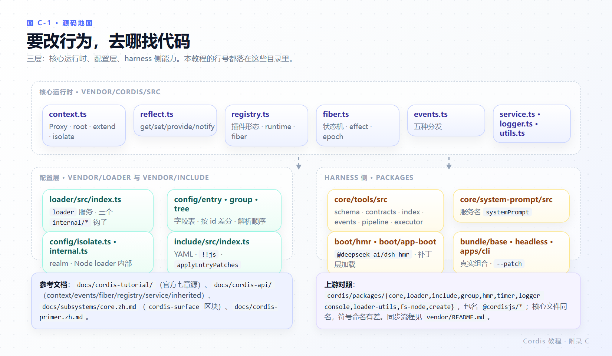

# 附录 C 官方文档与源码索引

本教程的所有陈述都能追溯到下面两类地址：**官方页面**（文档站，或仓库 `docs/` 内的同一份源）与**源码路径**（以 `deepseek-ai/deepseek-harness` 根目录计）。

---

## C.1 官方 Cordis 教程（七章）

文档站前缀：`https://deepseek-harness.github.io/deepseek-harness/develop/cordis-tutorial/`

| 官方页 | 仓库内源文件 | 本教程对应 |
|---|---|---|
| 索引（准备工作、章节表、TypeScript 说明） | `docs/cordis-tutorial/index.zh.md` | 第 1 章、第 2 章 2.1 |
| 1. 编写第一个插件 | `docs/cordis-tutorial/01-first-plugin.zh.md` | 第 2 章 |
| 2. 生命周期与 effect | `docs/cordis-tutorial/02-lifecycle-and-effects.zh.md` | 第 3 章 |
| 3. 服务 | `docs/cordis-tutorial/03-services.zh.md` | 第 4 章 |
| 4. 事件 | `docs/cordis-tutorial/04-events.zh.md` | 第 5 章 |
| 5. 配置 | `docs/cordis-tutorial/05-config.zh.md` | 第 6 章 |
| 6. 组合与 HMR | `docs/cordis-tutorial/06-composition-and-hmr.zh.md` | 第 7 章 |
| 7. 进入 harness | `docs/cordis-tutorial/07-into-the-harness.zh.md` | 第 8 章 |

每章的 `.i18n.yaml` 是双语配对记录；改英文源后要跑 `pnpm run verify-translation-pairing --write docs/...`（文件头部注释写明）。

## C.2 参考文档

| 页面 | 内容 | 什么时候查 |
|---|---|---|
| `docs/cordis-primer.zh.md` | 五个概念、分发模式表、waterfall 语义、Loader 配置 | 想快速核对措辞与语义 |
| `docs/cordis-api/context.zh.md` | `Context` 与 Proxy 行为的生成式参考 | 属性读写规则、`extend`/`isolate` |
| `docs/cordis-api/fiber.zh.md` | `ctx.effect`、错误码 `INACTIVE_EFFECT`、waterfall 重启否决 | effect 语义与错误码 |
| `docs/cordis-api/events.zh.md` | 五种模式、“否决”用词 | 事件写法 |
| `docs/cordis-api/registry.zh.md` | `RegistryService`、`Plugin` 形态与元数据 | 插件形态 |
| `docs/cordis-api/service.zh.md` | `Service` 基类与注册 | 自定义服务 |
| `docs/cordis-api/inherited.md` | mixin 到 `ctx` 上的方法清单 | 想确认某方法从哪来 |
| `docs/subsystems/core.zh.md` | `cordis-surface` 区块：harness 注册的服务与事件 | 取名之前、挂事件之前 |
| `docs/subsystems/approval.zh.md` | `approval/request` waterfall 策略点 | 写审批拦截 |
| `docs/event-producer-consumer.zh.md` | 生产者/消费者视角的事件设计 | 设计新事件 |
| `docs/architecture.zh.md` | 系统地图 | 找插件所在位置 |
| `docs/user/develop/basic/index.zh.md` | 第一个 Harness 插件（`--patch` 路线） | 从 Cordis 跨到 dsh 插件 |
| `docs/user/develop/basic/tool.zh.md` | `defineTool` 深入：呈现、更丰富 schema | 第 8 章之后 |
| `docs/user/develop/basic/config.zh.md` | 插件配置实践 | 第 6 章之后 |
| `docs/user/develop/framework/service.zh.md` | 服务定义/提供方/消费者，含 `service-isolation` | 第 7 章 `isolate` |
| `docs/user/develop/framework/events.zh.md` | 框架级事件设计 | 设计 harness 事件 |
| `docs/user/develop/practice/index.zh.md` | 三层能力设计 | 决定能力放在哪一层 |
| `docs/defensive-patterns/` | 防御式写法（含 `README.zh.md`） | 写错误与边界处理 |
| `docs/config-catalog.zh.md` | settings 侧配置目录 | volatile 与 settings 的关系 |

## C.3 源码地图



*图 C-1 · 核心在 `vendor/cordis/src`，配置层在 `vendor/loader/src` 与 `vendor/include/src`，harness 侧从 `packages/core/tools` 进。*

### 核心运行时（`vendor/cordis/src/`）

| 文件 | 负责 | 本教程高频引用 |
|---|---|---|
| `bin.js` | 16 行启动器：根 Context + Loader + Include `./cordis.yml` | 2.2 |
| `context.ts` | Proxy 装配、`root`、`extend`、`isolate`、`intercept` | 9.1、9.2 |
| `reflect.ts` | Proxy handler、`get`/`set`/`provide`/`notify`、mixin 注册 | 9.2、4.4 |
| `registry.ts` | 插件形态解析、runtime 与 fiber、`plugin`/`inject` | 2.4、9.3 |
| `fiber.ts` | 状态机、effect 与 disposer、epoch、`update`/`restart` | 3.3、3.4、9.5 |
| `events.ts` | `isBailed`、五种分发、`EventOptions`、hooks | 5.3、5.4 |
| `service.ts` | `Service` 基类与注册、`provide` 兜底名 | 4.2 |
| `logger.ts` | `LoggerService`、buffer 导出器、消息结构 | 2.5、9.5 |
| `utils.ts` | `DisposableList`（逆序 `clear`）、`composeError` | 3.4 |

### 配置层（`vendor/loader/src/`、`vendor/include/src/`）

| 路径 | 负责 | 引用 |
|---|---|---|
| `loader/src/index.ts` | `loader` 服务、三个 `internal/*` 钩子、`showLog` | 7.4、9.6 |
| `loader/src/config/entry.ts` | 配置项元数据、`!!js` 求值、解析失败只记日志 | 7.1、2.5 |
| `loader/src/config/group.ts` | 按 `id` 差分、`Promise.all` 并发启动 | 7.2、7.4 |
| `loader/src/config/tree.ts` | 解析顺序、随机 id、任务队列 | 7.4、9.6 |
| `loader/src/config/isolate.ts` | `isolate` / `intercept`、realm 换入换出 | 7.1 |
| `loader/src/internal.ts` | Node loader 内部结构（`--expose-internals` 或回退） | 7.3 |
| `loader/src/resolve.ts` | NPM 包名项目解析（就近写 `.cordis/resolve.mjs`） | 9.6 |
| `include/src/index.ts` | YAML 读取、`!!js` 标签、`applyEntryPatches` | 6.3、8.5 |

### 辅助插件

| 路径 | 包名 | 引用 |
|---|---|---|
| `vendor/timer/src/index.ts` | `@deepseek-ai/cordis-plugin-timer` | 7.3 |
| `vendor/logger-console/src/{shared,index}.ts` | `@deepseek-ai/cordis-plugin-logger-console` | 2.5、7.3 |
| `vendor/group/src/index.ts` | `@deepseek-ai/cordis-plugin-group` | 7.1 |
| `vendor/hmr/src/index.ts` | `@deepseek-ai/cordis-plugin-hmr`（上游 fork） | 7.3 |
| `packages/boot/hmr/src/index.ts` | `@deepseek-ai/dsh-hmr`（harness 实际用的） | 7.3 |

### harness 侧（第 8 章）

| 路径 | 内容 |
|---|---|
| `packages/core/tools/src/schema.ts` | `defineTool`、参数编译、校验、投影 |
| `packages/core/tools/src/contracts.ts` | `ToolDefinition`、`ToolExecution`、错误类 |
| `packages/core/tools/src/index.ts` | `ToolsService`（服务名 `tools`） |
| `packages/core/tools/src/events.ts` | harness 工具事件与 `@mode` |
| `packages/core/tools/src/pipeline.ts` | 执行流水线与 `tools/result` 发射 |
| `packages/core/tools/src/executor.ts` | `ToolBatchInput` / `ToolBatchResult` |
| `packages/core/system-prompt/src/index.ts` | `systemPrompt` 服务 |
| `packages/llm/llm/src/{types,brand}.ts` | `ToolCallBlock`、`ToolCallId` |
| `packages/util/brand/src/index.ts` | `brandString` |
| `packages/bundle/base/cordis.patch.yml` | 531 行真实组合 |
| `packages/bundle/headless/cordis.patch.yml` | 模式 overlay 样本 |
| `apps/cli/src/{args,profile-boot}.ts` | `--patch`、profile 层顺序 |
| `packages/boot/app-boot/src/index.ts` | 补丁文件加载与路径改写 |
| `packages/core/tools/tests/fixtures/literal-sdk.ts` | 最小正确工具夹具 |

### 上游参考（`cordis/packages/`，独立仓库）

`core`（同名文件，`symbols.*` 命名与 `root` 实现有差）、`loader`、`include`、`group`、`hmr`、`timer`、`logger-console`、`loader-utils`（上游 HMR 用它，vendor 副本不用）、`fs-node`、`create`。

## C.4 推荐阅读顺序

```text
第 1 章（概念 + 环境判别）
  → 第 2 章（跑通 + 静默失败机制）          ← 最重要的地基
  → 第 3 章（fiber/effect） → 第 4 章（服务/inject） → 第 5 章（事件）
  → 第 6 章（配置） → 第 7 章（组合/HMR）
  → 第 8 章（harness 工具）
  → 第 9 章（内核） / 第 10 章（排障）        ← 顺序可互换
```

排障时直接开 [第 10 章 10.1 四问排查法](10-pitfalls-and-debugging.md#101-四问排查法) 与 [附录 A](appendix-a-api-cheatsheet.md#a11-一段可复用的诊断头)。

## C.5 本教程的运行环境

| 项 | 值 |
|---|---|
| 检出 | `D:\workspace\harness\deepseek\deepseek-harness`（工作区内路径） |
| 核心版本 | `@deepseek-ai/cordis 4.0.6-alpha.1`（`vendor/cordis/package.json:4`） |
| 配置层版本 | `@deepseek-ai/cordis-plugin-loader 1.0.7-alpha.1`（`vendor/loader/package.json:4`） |
| 上游对照 | `cordis 4.0.0-rc.12`（`cordis/packages/*/package.json:2-4`） |
| Node / pnpm / tsx | v24.15.0 / 11.28.5 / 4.23.13 |
| 平台 | Windows 10 x64（`10.0.26300`） |
| 实测日期 | 2026-10-30 |

DeepSeek Harness 与 Cordis 都在快速演进。读到与你的代码不一致的地方，以你检出的版本为准；本教程每一处“实测”都给了能重跑的命令与文件，分歧处另见[第 10 章 10.5](10-pitfalls-and-debugging.md#105-本教程与官方文档的已知分歧)。
